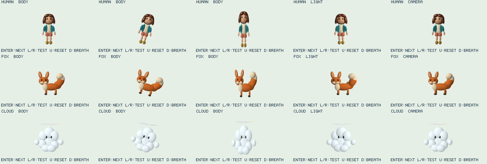

# CHARACTER LAB

3体を同じ光・カメラ・操作で比較する、材質/配置ユーティリティの最初の縦切り実装。APPS末尾に追加し、既存メニュー番号は変えない。`local.character` は `kasane.shapes` を必須とする。3体を同時常駐させず、切替時に旧sceneをdisposeする。

## 操作と時計

| 操作 | 動作 |
| --- | --- |
| Enter | HUMAN → FOX → CLOUD |
| 左右 | BODY / LIGHT / CAMERA / TEXTURE / EXPRESSION / STILL |
| 上 | 試験のframe時計を0へ戻す |
| 下 | 呼吸の上下移動ON/OFF。既定OFF |

BODYは固定世界光・固定カメラで、待機2秒 → 左右傾き3秒 → 圧縮伸長して基準形へ戻る3秒 → 停止2秒。以後は基準姿勢を保持する。雲の彩雲には解析的な0.18秒の遅れを付ける。乱数や積分状態には依存しない。LIGHTは光方向だけ、CAMERAは視点だけ、TEXTUREはキツネの尾の模様座標だけを変える。EXPRESSIONは半眼の変化に独立閉眼係数を重ねる。

`frame * 1000 / 30` は試験の補間位置を定義する時計で、実機で10秒になる保証ではない。実時間による評価と実機性能は未計測。

## モデルと因果関係

参照図3枚を実際に取得・目視してからモデルを作った。設定図の画素を描画assetとして使わず、楕円体の親子配置から形状/法線を生成する。

- 人: 栗色ボブ、teal jacket、cream shirt、coral shorts、mustard boots。髪/布/肌の係数を分け、額・鼻・頬・耳を別部位にする。肌の厚みをツヤ係数へ直結させない。
- キツネ: 四足、大耳、丸い胸毛、曲がる大きな尾、せり出した二つのマズル。白い尾先はbody UVの固有模様。光方向を変えても白模様そのものは照明から独立している。
- 雲: 白～淡青の重なる体積、脚なし、離れた手。頭上の薄い水平な彩雲は空隙を保つ別node。materialの透過項は形状/法線/世界光へ応答する。

native `shapes.ellipsoid` とorthographic cameraで解析的な曲面を描く。雲の材質にはopacity/edgeSoftnessを指定し、境界を背景へ合成する。低分割facetによる初期試作は品質上受け入れず、製品pathから削除した。現在のutilityは解析rendererのないbackendを明示的に拒否する。



設定図の貼付けではなく、同じmodel/utilityを実rendererで描いたhost capture。実機パネル画像や完成品質の証明ではない。再現は `run_character_app_host.py --ppm .cache/character-native/frames` と `tools/character/native_contact.py`。[実装・計測記録](../../docs/perf/character-materials.md)も参照。

設定図の柔らかな髪/毛/雲の再現を達成したとはしない。相互落影と真の体積散乱は未実装。透過光は法線/光/厚みへ応答する様式化近似で、境界alpha合成とは別である。物理散乱や多重透過を保証せず、質感の受入にはnativeの連続frameと実機画像の検証が必要。

## 再現できるhost検証

```powershell
node tools/character/test_lab.cjs
python tools/kasane_contract/run_character_app_host.py
```

Nodeは実際のentry/chunkを読み、model/mode切替・reset・呼吸と固定text容量をAPI stubで確認する。ネイティブ描画の正しさを代用する検査ではない。Python runnerは実QuickJS・native shapes・Kasaneの帯描画を使うhost検査で、ビルドにLinuxのC環境が必要。実行結果と未検証項目は最終headの報告を優先する。

hostの通過はdevice時間・native総空き/最大連続・コンパイルpeakの合格ではない。typedBytesもutility typed配列だけで、JS全heapやnative frame確保を含まない。fps/実機メモリの保証値はまだない。

`main/CMakeLists.txt` はentryを埋め込み、`chunks.txt` でutility/model/labを別評価する。hostはNodeのVMで同じ3chunkを評価する。frame構築/commitとviewの所有者はapp、geometry/dirty依存/型変換の所有者はutility、native shadeは汎用数値処理でキャラ名を知らない。
