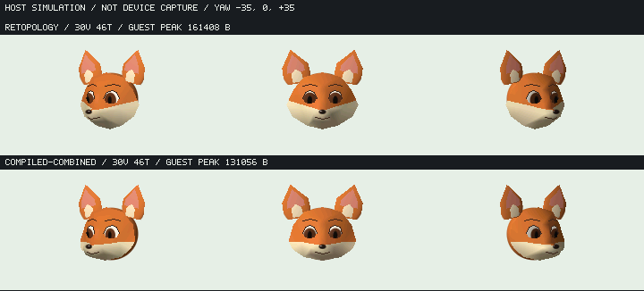

# FOX SHEET（中立表情のnative資産候補）

`local.foxsheet` / typed catalog名 **FOX SHEET**。固定3D形状・材質・topologyをcompiled native資産として直接使う比較候補。既定のFOX FACEとその4表情は置き換えない。画像パーツ版や完成した狐キャラクターではない。

画像は240×135の**ホストシミュレーション**。物理LCDの受入ではない。顎の丸みと白目は前進したが、白橙の横帯・狭い口線・頬毛・浅い眼窩・斜めのskull接合は未達。中立表情・yaw／世界光の操作に限定する。頂点表情morphや自律演技を完成したとは扱わない。

## 操作

| 入力 | 動作 |
| --- | --- |
| LEFT / RIGHT | yaw −35 / 0 / +35°の範囲で変更 |
| DOWN | 世界光を0 / +60 / −60°へ変更 |
| UP | Model/Instanceをrelease／reload |
| ENTER | 中立viewへresetしてload |

正式app catalogとNATIVE_APP経路へ登録している。既存の物理HOME shell一覧は変更していない。実機a418にはこのappを配置しておらず、新headの正式build／承認されたflash／fresh catalog確認は後段。

releaseでは個体arenaとModel参照を解放するが、appが所有するdisplay resourceと補助配列は再読込み用に保持する。提出済み画像は数値snapshotとして残り、RELEASED表示でも参照切れにならない。app終了のruntime解放とは別段階である。

## 所有と更新

- `assets/fox_sheet.aynm` / `_bytes.inc` は1つの選択資産（3512 B）。通常providerの`fox-sheet`がconst spanを返す。5比較条件を通常firmwareへ無条件に含めない。
- 個体は既存Ayatsuri Model/Instanceを使い、pose・world matrix・投影・陰影・可視面packetを可変arenaへ持つ。JSへrest mesh graphを再展開しない。
- `FoxSheetScene.create(data)`はapp専用viewer helper。既定ではUIを公開せず、appが`K.replace`を所有する。host単独fixtureのみ明示`{present:true}`。同frameの二重replaceを避けるため、描画とview公開を分けた。
- 鼻の解析primitive、眼／眉／口のoutline、耳clip補助はJS側に残る。全データ／計算のnative化とは呼ばない。

再生成は `node tools/ayatsuri/model/export_fox_patch.cjs --promote`、差分を出さない検証は `--check-product`。通常のfixture生成は`.cache/fox-compiled-assets/`へ書き、製品資産を勝手に上書きしない。

[API契約](../../docs/api/ayatsuri-native-mesh.md) · [資源と画質比較](../../docs/perf/fox-native-asset-study.md)
