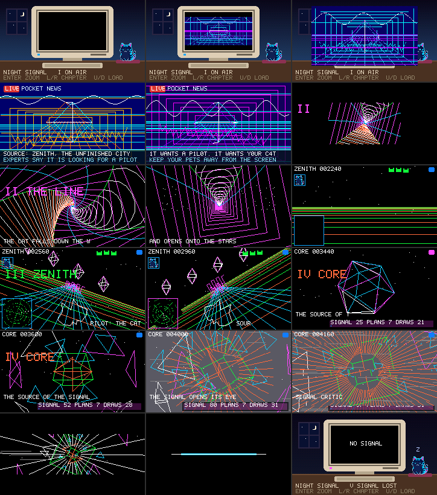
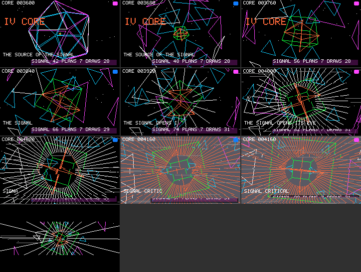
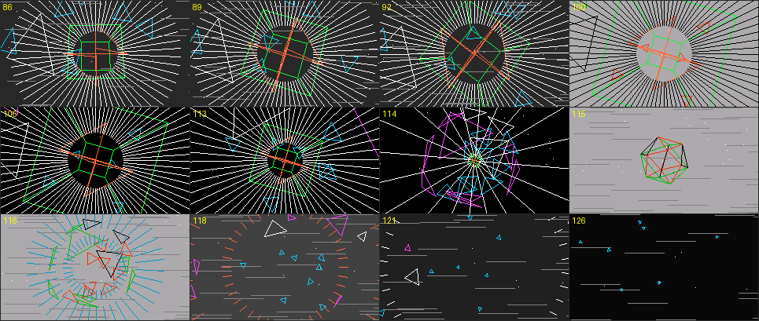
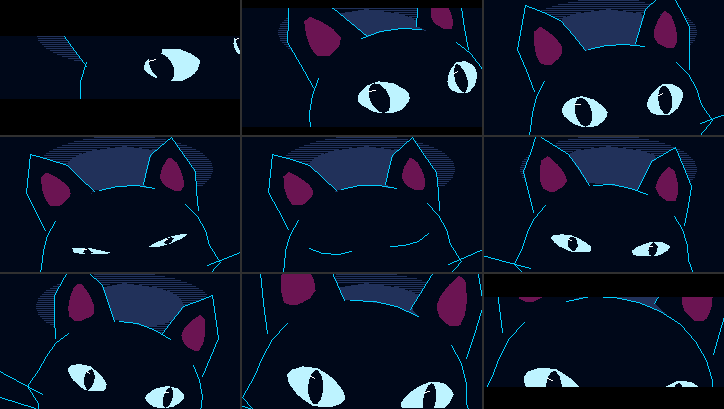

# MEGADEMO — NIGHT SIGNAL（シナリオと演出の設計）

2026-10-27。対象は [apps/kasane/proc_megademo.js](../../apps/kasane/proc_megademo.js)（APPS の MEGADEMO）。上限を叩く場面の設計と数値は [megademo-limit-scenes.md](../kasane/megademo-limit-scenes.md)、実機の測定は [megademo-device-limits.md](../kasane/megademo-device-limits.md)。この文書はそれらの上に「物語」と「場面のつなぎ」を足したときの台本と、何をどこで変えたかの記録。

> **2026-10-28 以降の物語は「ASTRAL FIGHTER」**（下の [ASTRAL FIGHTER](#astral-fighter2026-10-28) の節）。その前の NIGHT SIGNAL の台本（猫がテレビの信号に呼ばれる話）は、場面の中身（Act I〜CORE の手続き面）の記録としてそのまま残す。アプリは 2026-10-28 から 4 つのチャンクに分けた（`apps/kasane/chunks.txt`、同じ節）。

## なぜ作り直したか

旧版は NEWS×3 → TWIST → ZENITH → LIMIT の6場面を順に流すだけで、場面どうしに因果も絵のつながりもなかった。

- NEWS は全画面だと手続き面の画しか見えず、裏のニューススタジオ（矩形 17 個）は小窓（Enter）にしたときしか見えない。
- Act II の「机の上のモニターとペット」は、小窓にしたときの背景でしかなく、何も起きない。
- 場面の切替はハードカット。TWIST の題字（TWISTED CORRIDOR）だけが場面の名札で、ほかの場面には名札もない。

負荷試験としての中身（各場面の plan・上限の使用率）はそのまま価値があるので残し、**外側（部屋・ペット・HUD・場面の頭と尻）を物語の器にする**。

## あらすじ

> 真夜中。古いコンピューターの前で、猫が眠っている。
> 画面がひとりでに点き、深夜のニュースが「軌道からの謎の信号」を伝える。発信源は、建設途中の都市 ZENITH。信号はパイロットを探している — あなたの猫を。
> 猫は画面に吸い込まれ、ねじれた回線を落ちていき、星空へ抜け、猫の顔をした機体で ZENITH の上空を飛ぶ。信号の結晶（正八面体）を追い、発信源を捕捉する。
> 発信源は、宇宙に浮かぶ正二十面体の殻。近づくと殻が花びらのように開き、中で立方体と正八面体の核が脈打つ。信号が臨界へ向かうにつれ、画面がグレーに瞬き、電波障害で横に裂け、視界が引き伸ばされる。
> 過負荷。画面は一本の線になり、点になって消える。カメラが部屋へ引くと、猫は元の座布団で眠っている。モニターには NO SIGNAL。
> ……そしてまた、画面がひとりでに点く（ループ）。

## 構成と仕掛け

**部屋が「現実」、モニターの中が「物語」。** 旧版の小窓（Enter で全画面⇄モニターの中）を、物語の装置として使う。

- ループの頭（第 I 章）は部屋から始まり、テレビが点いてから自動でモニターへ寄る。ループの尻（第 V 章）は画面が消えてから自動で部屋へ引く。
- 猫は第 I 章の終わりにモニターへ吸い込まれ、第 II〜IV 章の部屋には空の座布団だけが残る（小窓にすると「猫がいない」ことが分かる）。第 III 章の HUD には操縦席の猫が映る。第 V 章で座布団に戻って眠っている。
- 部屋の壁は、その章のモニターの光の色に染まる（I 青、II 紫、III 緑、IV 橙、V 消灯）。

**Enter の小窓・LEFT/RIGHT の場面送り・UP/DOWN の負荷段階は従来どおり。** 自動の寄り・引きはユーザーの選んだ状態を上書きしない:

- Enter で小窓にした（固定した）ら、第 I 章の自動の寄りは起きない。もう一度 Enter で全画面に戻すまで部屋のまま。
- 第 V 章の自動の引きは、全画面のときだけ起きる（小窓ならもう部屋にいる）。
- 自動の寄り・引きは Enter の倍の速さ（1 フレーム 2 段、22 フレーム）。

## 章立て（1 周 524 フレーム、HEAVY で約 21 秒）

| 章 | 場面（ログ名） | フレーム | 中身（手続き面） | 物語の拍 |
| --- | --- | ---: | --- | --- |
| I ON AIR | NEWS ×3 | 32×3 | Act I の放送グラフィック（ゲート・ハイウェイ・バー・正弦・走査線・結晶）。各 16 フレームの拍を 2 回ずつ | 部屋で猫が眠る → 2〜10 フレームでテレビが点く（シャッターが中央から開く）→ 12 で猫が起きる → 14 から画面へ寄る（36 で全画面）。下帯のテロップ: 謎の信号 → 発信源 ZENITH → 「パイロットを探している、あなたの猫を」。3 拍目の後半で画面が横に揺れ、テロップが化ける。部屋では猫がモニターへ歩き、縮んで画面へ消える |
| II THE LINE | TWIST | 128 | ねじれ廊下（入口はアイリス）。88 から星が消失点から噴き出し、108 から廊下が枠・アーチ・レール 2 本に痩せ、120 から星だけ | 回線を落ちていく。ねじれが最大になって戻る。出口が星空に開く。**切替の瞬間の星は ZENITH の 0 フレーム目と同じ配置**（基底の倍率 1、位相 0） |
| III ZENITH | ZENITH | 96 | 地平線・地面・車線・スカイライン・結晶の編隊・レーザー・**猫の顔の機体**（耳の付いた 15 点の点列）・レーダー | 操縦席の猫（HUD の左上）。40〜63 でバレルロール。48 で残機が 1 つ減る。72 で「SOURCE LOCKED」、レーダーの枠が橙、ランプが速く点滅 |
| IV CORE | CORE | 140 | 正二十面体の殻（0〜40 で近づく）が 40〜56 で花びらのように開き、立方体と正八面体の核が現れる。64 から放射線。60〜100 が臨界の溜め（グレーのフラッシュ・電波障害・84 からめまいズーム、86 からコマ送り）。100〜112 が時間停止（ネガ）、112〜115 で殻が中心へ潰れ、115 にネガで炸裂、破片と衝撃波が広がる（2026-10-28 に旧 LIMIT から差し替え、下の節） | 計器が SIGNAL 0 → 100 に上がる。100「IT HOLDS ITS BREATH」、115「AND BREAKS」。132〜140 で画面が上下から閉じて一本の線になる（HUD ごと） |
| V SIGNAL LOST | LOST（新） | 64 | 横線が縮んで点になり（0〜19）、点も消える。以後は黒 | 12 から部屋へ引く（34 で部屋）。猫は座布団で眠り（z Z z）、モニターに NO SIGNAL が点滅、電源ランプが赤く明滅 |

### 場面のつなぎ（マッチカット）

| つなぎ | 前の場面の尻 | 次の場面の頭 |
| --- | --- | --- |
| V → I | 部屋。モニターは NO SIGNAL | 同じ部屋。モニターのシャッターが中央から開いて放送が映る |
| I → II | ニュースのゲート（矩形の枠）。画面が乱れ、猫が画面へ消える | ねじれ 0 の廊下 = ゲートが奥へ並んだもの。アイリスで入る |
| II → III | 廊下が消え、星だけになる | 同じ星空（同じ配置）。地平線と機体が現れる |
| III → IV | SOURCE LOCKED | 同じ星空の奥に、発信源の殻が小さく回っている |
| IV → V | 上下から閉じて一本の横線 | 同じ位置の横線が左右から縮んで点になる |

（host の実レンダラで合成したパネル。実パネルの撮影ではない。0, 8, 24, 60, 90, 92, 104, 130, 180, 212, 224, 262, 300, 326, 360, 412, 418, 476 フレーム目）

## 画面の要素

### 部屋（カメラが画面から離れているときだけ組む）

全画面のときは手続き面の画像が部屋を完全に覆うので、部屋を組まない。カメラが 1 段でも引いたフレームで、部屋を含めて組み直す（`replace`。キーは場面・段階・部屋の有無）。全画面のコマンド数は旧版より少ない（NEWS 20 → 12、TWIST 9 → 6）。

- 壁: 縦グラデーション（ディザ）、下側がその章の光の色。
- 窓: 枠・夜空・三日月（円 2 枚の重ね）・星 3 つ・桟。
- 机と縁、モニター（筐体・画面枠・電源ランプ・ドライブの口・台）、キーボード、座布団。
- 猫（`pets` の variant 3 = ネオン猫。コマ 0 = 起きている、1 = 眠り目）。I と V だけに居る。40 フレームに 1 回まばたき。
- 下 2 行: 章の名前（`NIGHT SIGNAL   III ZENITH`）と操作の案内（`ENTER ZOOM  L/R CHAPTER  U/D LOAD`）。
- モニターの上: NO SIGNAL と z Z z（V のみ、部屋に引き切ってから）。
- シャッター: 画像の現在の矩形の上下を黒で覆う 2 枚。セットの最後に作るので HUD も覆う。`setRect` は clip を動かさないので clip は全画面。

部屋とニュースの帯は `"x0 y0 x1 y1 rrggbbaa 半径|-線幅|不透明度"` の文字列の表で持ち、組むときに分解する（数値の配列リテラルよりゲストに残るものが少ない）。

### 全画面の HUD（全画面のときだけ見える）

- 章の名札（`display`、タイプライター、4〜59 フレーム）: II THE LINE（紫）／III ZENITH（緑）／IV CORE（橙）。
- ナレーション（`caption`、1 行、1 フレーム 1 文字）。拍で文が替わる。II は下端、III は右下（機体を隠さない）、IV は計器の上（THE SOURCE OF THE SIGNAL → THE SIGNAL OPENS ITS EYE → SIGNAL CRITICAL）、V は中央（NO SIGNAL）。
- I: LIVE の赤札・局名・半透明の下帯とテロップ 2 行。
- III: 旧版のスコア・ランプ・レーダー（ネイティブ回転）・残機（猫の頭の形の cache、矩形 3 つ）に、操縦席の猫（`pets` を 17×17 に縮小）を足した。
- IV: 旧版の半透明の計器板。文言は `SIGNAL nn PLANS n DRAWS n`（フォントに `%` が無い）。レーダーは III だけに残した。

## 変えなかったもの

- Act I の手続き面（`program` / `inputs` / `pointBatch` / `backdrop`）。C 参照（`proc_megademo.h`）と全画素一致の検査をそのまま通す。再生は各拍を 2 回ずつ（`t % 16`）。`ACT1` の文字列は `+` 連結を行継続の 1 リテラルにしたが、中身は同一（`program()` の出力を新旧で比較）。範囲検査の `checkPhase` などは、どの試験も使っていないので外した。
- 負荷段階 `KN` の TWIST・ZENITH の数値と plan の中身（ZENITH の機体の点列だけ差し替え、倍率 1.7 → 2）、動的 plan 読み込み（`LOAD`）。（IV は 2026-10-28 に作り直した。上の節）
- 操作: Enter（全画面⇄小窓）、UP/DOWN（負荷段階）、LEFT/RIGHT（場面送り）。
- ログの契約: `MEGADEMO SCENE <名> tier=… plans=… freed=… registered=…`、`MEGADEMO VIEW <名> commands=…`、`MEGADEMO IMAGE FIXED_PIE / DYNAMIC_STRETCH`、`MEGADEMO DEGRADE`、`MEGADEMO ANIM`。場面名に LOST が増えた。

## 外したもの（メモリ）

ZENITH の **munching squares の小窓**（`pocket.kasane.pixel`）と **レーダーの縮小画像**（面1を `nearest` で 60×34 にして `setRotation`）。どちらも物語に役がなく、HEAVY では縮小画像の回転は 0° だった。

- ゲスト: 型付き配列を 1 つでも作ると、その機構だけで約 1.3 KB が常駐する（host m32、`new Uint16Array` 2 つで +1,312 B、`pixel.open` で +688 B）。2 つを外して評価後 −3.0 KB（host m32、103,488 → 100,464 B）。
- ネイティブ: pixel のプール 1,888 B（`sizeof(ksn_pixel_pool)`、host m32）と、縮小のソース行 `resize_stream`（約 1.3 KB）が確保されなくなる。
- 網羅表（[megademo-limit-scenes.md](../kasane/megademo-limit-scenes.md)）の `pixel.open` / `stage`、`sampling: 'nearest'`、`ref.setRotation` はこのアプリでは使わなくなった。`pixel` の試験は `apps/kasane/pixel_lab_probe.js` などにある。

## IV CORE の作り直し（2026-10-28）

実機で通しを見たユーザーの感想「ストーリーラインはいい。派手な 3D がもっと欲しい。最後のぐちゃぐちゃの場面（旧 LIMIT の重ね合わせ）を切って新しい 3D を」を受けて、第 IV 章を差し替えた。候補 3 案（ワイヤーのトーラスをくぐる／正二十面体の殻が開く／3D ロゴ）から B を選び、臨界の演出はユーザー案（グレーのフラッシュ・電波障害・弱いめまいズーム、どれも山場へ向けて強める）を入れた。イメージボード: [6 コマ](megademo-core-board.svg)、[臨界のタイムライン](megademo-core-critical.svg)。

### 時間割（140 フレーム。100 以降は下の「臨界の締め」で差し替えた）

| フレーム | 殻 | 核・放射線 | 臨界の演出 |
| --- | --- | --- | --- |
| 0〜40 | 遠景から近づく（倍率 18 → 62、smoothstep） | — | — |
| 40〜56 | 20 枚の面が縮み（×0.65）、法線方向へ 0.8 離れ、交互の向きにねじれる | 核が 0 → 1 に現れる | — |
| 56〜76 | 開いたまま回る | 核が脈打つ（±15%）。64 から放射線が増える | — |
| 60〜100 | 76 からさらに開き（+0.6）、ねじれが 1.5 倍、回転が加速 | 放射線が伸びる（30 → 150 px） | グレーのフラッシュ（下）、電波障害（強さ u^1.5）、84〜100 にめまいズーム |
| 100〜140 | 下の「臨界の締め」 | | |

- **グレーのフラッシュ**: 背景を 1 フレームだけ `#5a5a64`（RGB565 0x5acc）にする。白は使わない（目に悪い）。光るのは `9·u³`（u は 60〜100 の進み）が整数をまたいだフレーム = 60, 80, 85, 88, 91, 93, 95, 97, 99, 100。間隔が 20 → 1 フレームに詰まる。光ったフレームの放射線は橙。
- **電波障害**: 手続き面の走査線ノイズ（plan `nz`、`BREAK_IF_GT` で本数を打ち切る、灰色の横線）と、画面画像を横帯に切って左右にずらした `image` 3 枚（`clip` と `setRect` をフレームごとに変える）。どちらも強さは `u^1.5`。帯の位置・ずれ・出る／出ないはフレーム番号のハッシュ。
- **めまいズーム**: 投影 `f = s·D/(D+z)` のカメラ距離 D を 84〜100 で 3.2 → 1.6（`ramp²`）。z ≈ 0 の核の大きさは変わらず、手前・奥の破片と星（基底を ×1.8）だけが外へ引き伸ばされる。16 フレームだけ。
- **3D の計算は JS、描画は plan**: 頂点の回転・投影・面の開き方は JS（`core()`）で、plan は線を引くだけ（`tri` 三角形 1 枚・色は入力から、`qd` 閉じた四角、`sg` 線分 2 本、`ry` 放射線、`st` 星、`nz` 走査線ノイズ）。立方体・正八面体の頂点はビットから作り、正二十面体は頂点 36 個の配列 1 本と面の 16 進文字列で持つ（配列 46 個で持つ版は評価後 +12.4 KB だった）。面の z がレンズを越える分母は `max(D+z, 0.4D)` で止める（越えた版は draw が失敗した）。

### 臨界の締め（2026-10-28 追記）

実機を見たユーザーの感想「臨界の演出が弱い。最後に爆発、カタルシスがほしい。ネガポジ反転フラッシュや時間停止・コマ送りを」を受けて、100 以降を作り直した。旧版は 100〜110 で全部が中心へ縮んで終わるだけで、溜めた分の解放が無かった。CORE は 112 → 140 フレームになった。

| フレーム | 時計 g | 画面 |
| --- | --- | --- |
| 86〜100 | 3 フレームごとに進む（コマ送り） | 進んだフレームだけ背景が暗いグレー（`#282828`、0x2945）。グレーのフラッシュ（明るい方）は 86 まで |
| 100〜112 | 100 で止まる（時間停止） | 100・101 がネガ: 背景を明るいグレー（0xad55）、殻と放射線の色を反転（`c ^ 0xffff`）。HUD（得点・ランプ・計器）と電波障害の帯も止まる（`patch` が何も書き換えない）。走査線ノイズは消える。「IT HOLDS ITS BREATH」 |
| 112〜115 | 100 のまま | 殻が中心へ潰れる（開き → 0、倍率 ×0.5）、核も潰れて消える、めまいズームが戻る |
| 115・116 | | ネガ。潰れた正二十面体が反転色で一瞬見える（炸裂の瞬間）。「AND BREAKS」 |
| 115〜133 | | 炸裂: 面が法線方向へ 0 → 3.6 飛び、5 rad 余分に回り、0.4 倍まで縮む。衝撃波の輪（放射線の plan で短い線の輪、半径 6 → 156、最初の 3 割は橙）と、外へ投げ出される放射線（本数が 1 → 0）。星が外へ流れる（×2.4）。走査線ノイズと帯が 1 → 0。背景の残光（暗いグレー → 黒、117〜129） |
| 132〜140 | | シャッターが閉じる。残った破片が漂う |

- **白は使わない**（前の版の方針どおり）。ネガの背景も白ではなく明るいグレー。ネガは 4 フレーム（100・101・115・116）だけで、連続の明滅は作らない。コマ送りの暗いグレーは 3 フレームおきで、輝度の差が小さい（光感受性への配慮。点滅の頻度の目安は 1 秒 3 回以下）。
- **炸裂を「潰れてから広げる」形にした理由**: 最初の版は開いた殻（開き 1.6、めまいズーム中）をそのまま外へ飛ばしたが、カメラが殻の内側に入っていて、破片は次のフレームで画面外へ出た（絵にならなかった）。一度中心へ潰す（3 フレーム）と、破片が中心から画面端まで約 15 フレームかけて広がる。
- **線分のコスト**: 手続き面は線を画面で切らずに長さぶん数える（1 フレーム 8,192 ステップ）、座標は −480〜720 の外で `INVALID`。炸裂中は面の辺の長さの和を 4,000 ステップまでに抑え、頂点が画面から 200 / 140 px 以上外れた面は描かない。星の倍率は 2.4 で止める（3.8 にした版は座標の範囲を超えて draw が失敗した）。
- **吸い込まれる塵**（ユーザー案、同日追記）: コマ送りが本物のフレーム落ち（資源の枯渇）と見分けられるように、76〜115 に塵を浮かべる。塵は殻の時計 g ではなく実時間 t で毎フレーム動く（殻が止まっていても塵は流れる）。8 本の輪（`ry` で 1 輪 = 同じ半径の短い線を等間隔に、HEAVY で 10 本）が 36 フレームで外から核へ落ちる。半径は落下の進み u の平方根（r = 24 + 116√u）なので、核に近いほど速く、筋も長くなる（重力）。角度は 30/(r+9) で、内へ行くほど巻く。色は橙と水色（白い放射線と区別するため。放射線は 78〜88 で 4 割まで間引く）。時間停止の間は止まり、112〜115 の潰れで核へ吸い込まれて消える。
- **メモリ**（host m32、`run_megademo_app_host.py --m32`。評価後・評価のピーク、B）: 締めの前 f961667 が 103,228・139,372、締め c24cc14 が 105,060・143,792、塵を足した版が 105,572・147,744（上限 163,840 まで 16.1 KB）。**この節の最初の版に書いた「+56 B」は誤り**（`--baseline-rev` の既定 HEAD の行を今の版の値と読んだ）。コメントを全部消してもピークは変わらない（147,744）。塵を別の関数に切り出すと逆に 149,508 に増えた。plan は増やしていない（衝撃波の輪も塵も放射線の `ry` を使う）。
- **実機**（2026-10-28、8bd67c8、broker の `app_session` 90 秒、HEAVY）: 4 周 + α を通して `DEGRADE`・エラー・OOM なし。1 周 18.65 s（締めを入れる前 17.3 s、CORE が 28 フレーム長くなった分）。CORE の 140 フレームは 5.65 s（平均 24.8 fps、30 フレーム窓で 23.2〜26.4 fps。JS のターン 9.7 → 23.5 ms、描画 8〜12 ms）。締めを入れる前（24〜29 fps、ターン最大 ~21 ms）とほぼ同じで、炸裂の区間で重くはなっていない。評価後の空き 102,416 B（最大の連続 32,768 B、JS 88,484 B。前の版は 104,012 B）。

### 負荷とメモリ（host）

| 段階 | plan | draw/フレーム | 線分最大 | ラスタ最大 | draw ステップ最大 |
| --- | ---: | ---: | ---: | ---: | ---: |
| LIGHT | 7 | 30 | 140 | 6,526 | 420 |
| MID | 7 | 30 | 208 | 9,254 | 1,032 |
| HEAVY | 7 | 31 | 264（上限 1,024 の 26%） | 14,210（65,535 の 22%） | 1,032 |

旧 LIMIT（plan 14、HEAVY で線分 1,010・ラスタ 58,000）にあった「仕様上限まで叩く」役目は無くなった。VM 側は軽く、重いのは JS 側（毎フレーム 20 面 × 3 頂点の投影と 31 回の `draw`）。実機の fps は未測定。

ゲスト（host m32、`run_megademo_app_host.py --m32`、旧＝`main` 5ba71e6）: 評価後 100,616 → 106,788 B（+6.2 KB）、実行中の live 最大 114,904 → 120,568 B（+5.7 KB、どちらも ZENITH）、評価のピーク 130,744 → 141,056 B（+10.3 KB、上限 163,840 まで 22.8 KB）。plan は 14 → 7 本でネイティブ側は減る（plan 1 本 40 + 12 × 命令数 B）。

**DERBY の `@plan`／ROM plan に移す案**（ユーザー提案）: Act II の plan の文字列を空にした場合の上限で、評価後 −3.9 KB・評価のピーク −3.8 KB（host m32）。VM の負荷が上限から遠いので今回は入れていない。入れるなら MEGADEMO をチャンクのアプリにして、場面の検査（`test_proc_megademo_scenes.c` が JS から plan を読む）を ROM 表から読む形に直す必要がある。

### 実機で起動しなかった件（2026-10-28）

CORE を入れた版は、実機で起動に失敗した（`EVAL_ERROR PocketError: frame allocation failed at beginFrame`）。MEGADEMO は手続き面のフレーム（10,246 B の連続領域）を起動時にまとめて確保していたが、2 面（面1 = ZENITH のレーダー）で 5 枚、約 51 KB が要る。評価後の実機の空きは 102,088 B あったが、最大の連続領域が 31,744 B で、5 枚が入らなかった（JS 88,692 B。#103 の版は 82,784 B で通っていた）。

- 確保を評価中から最初の `frame()` に移した（コンパイル後の一時メモリが消えてから）。これだけでは足りなかった（同じ失敗）。
- **面1をやめた。** ZENITH のレーダーは、面1に描いて `animate` で回していたのを、面0の左下に直接描く（plan `rd` = 多角形の輪 + 十字、`sw` = 掃引と輝点、中心 (28, 108)）。フレームは 3 枚（約 31 KB）になり、常駐の native も 2 枚分（約 20 KB）減る。レーダーの回転表示（HEAVY のみ）と、その帯の再描画（実機で約 23 ms/フレーム）も無くなる。`MEGADEMO ANIM` のログも無くなった。
- host m32 のゲスト: 評価後 103,172 B（`main` +2.6 KB）、実行中の live 最大 116,204 B（+1.3 KB）、評価のピーク 139,316 B。

### 実機（2026-10-28、CORE の版 = PR #104 dbc33fb、main に PR #93 込み）

ブローカーの `app_session` で MEGADEMO を HEAVY で 90 秒（約 5 周）動かした。

- DEGRADE・OOM・`PocketError`・例外は 0。停止・後片付けまで正常（`stop`/`close` ok、HOME へ戻る）。1 周 17.3 秒。
- fps（`KASANE_PAINT` の 30 フレーム窓）: NEWS・TWIST・LOST 約 30、**ZENITH 約 30**（面1をやめる前は 18〜19）、**CORE 24〜29**（臨界の後半ほど重い。JS のターン 9 → 21 ms、描画 8〜12 ms）。
- 空き heap: 評価直後 104,012 B（最大連続 31,744 B）、JS 86,720 B。この後の最初のフレームで 3 枚のフレームを確保して通った。終了後 208,224 B。
- 面1あり・評価中に確保していた版は `frame allocation failed` で起動しなかった（上の節）。

## 実装と結果

### メモリ（host m32、TLSF の課金。実機では未測定）

`python3 tools/kasane_contract/run_megademo_app_host.py --m32`、旧版は同じハーネスで `git show HEAD:apps/kasane/proc_megademo.js`（960 フレーム、ZENITH を 2 回通す）。

| | 旧版 | 新版 | 差 |
| --- | ---: | ---: | ---: |
| ソース | 28,247 B | 32,980 B | +4,733 |
| 評価中のピーク（コンパイル） | 117,284 | 130,672 | +13,388 |
| 評価後 | 97,580 | 100,544 | +2,964 |
| 実行中の live 最大（毎フレーム GC 後、どちらも ZENITH） | 110,124 | 114,832 | +4,708 |

- 評価のピークは上限 163,840 B まで 33 KB 残る（旧版 46 KB）。
- 実行中の常駐はゲストで +4.7 KB、ネイティブで −3.2 KB 程度（上の「外したもの」）。差し引き ZENITH で約 +1.5 KB の見込み（推定）。実機の ZENITH HEAVY のターン内の最小空きは 6,948 B（[megademo-device-limits.md](../kasane/megademo-device-limits.md)、2026-09-29）なので、**実機で `tools/kasane_contract/megademo_device.py run` の空き最小を確かめる必要がある**。
- 途中の版は live 最大 +12.5 KB だった。削ったもの: 型付き配列（上）、部屋とニュースの表を文字列に、HUD の表示窓をクロージャから数値の組に、ナレーション・テロップを 1 本の文字列にして場面ごとに分解。コメントの量は効かなかった（コメントを全部外しても評価のピークは ±0.1 KB）。

### 負荷（host 計数、`run_proc_megademo_scenes.py`。2026-10-27 の版。LIMIT は 10-28 に CORE へ差し替えた）

| 段階 | 場面 | plan | 線分最大 | 線分平均 | ラスタ最大 | draw ステップ最大 |
| --- | --- | ---: | ---: | ---: | ---: | ---: |
| HEAVY | TWIST | 8（+1 星） | 626 | 584.3 | 19,213 | 1,807 |
| HEAVY | ZENITH | 16 | 264 | 199.8 | 11,368 | 1,032 |
| HEAVY | LIMIT | 14 | 1,010 | 678.3（旧 791.2） | 58,000 | 9,817 |
| 共通 | LOST | 2 | 3 | 0.9 | 627 | 6 |

LIMIT の平均が下がったのは、序盤で層を足していくため（最大は不変）。ZENITH の線分が 266 → 264 なのは機体の点列が 17 → 15 点になったため。

### 検査（host）

| 検査 | 結果 |
| --- | --- |
| `run_proc_megademo_scenes.py`（3 段階 × 7 場面 × 全 1,296 フレーム、plan・単歩・VM の一致、Act I は C 参照と全画素一致、上限の検査、15 opcode） | PASS。ハッシュ programs `6472050e2a2dbf89` pixels は版ごとに変わる |
| `run_proc_megademo_js.py`（Act I の programs と C 参照、0〜95 フレームの draw、ズームの切替、942 フレームの読み込み） | PASS（拍を 2 回ずつ、縮小ソース 1 つ、部屋の組み直しに合わせて試験を更新） |
| `run_megademo_app_host.py`（ASan/UBSan と `--m32`、1,264 フレーム、ズーム・段階・場面送り） | PASS。例外 0・DEGRADE 0・表示失敗 0、同時 plan 最大 16 |
| `run_pocket_proc_qjs.py`（実 `pocket_proc.c` で 0〜95 フレームが Act I の参照と全画素一致、ズーム往復） | PASS（拍を 2 回ずつ、部屋から始まるカメラ、部屋の組み直しの REPLACE に合わせて試験を更新。`--out` の書き出しは参照フレームの番号で 1 回ずつ） |
| Kasane のコマンド数（表示中） | 最大 43（ZENITH を部屋から見たとき）。上限 80 |

`MEGA_PICKS=0,8,…` を付けると `run_megademo_app_host.py --ppm` の書き出すフレームを選べる（このために足した）。

### 実機（2026-10-28、CORE 差し替え前の版 = main 5ba71e6）

PR #93（ブローカーからアプリを起動する app-control-v1、ドラフト）を一時的に重ねたファームで、ブローカーの `app_session` から MEGADEMO を HEAVY で 90 秒（4 周半）動かした。終わった後は `main` のファームに戻した。

- DEGRADE・OOM・`PocketError`・JS の例外は 0。場面の切替と plan の読み込み（同時最大 16 本、ZENITH）は毎周同じ。1 周 19.1 秒。
- fps（`KASANE_PAINT` の 30 フレーム窓の間隔から）: NEWS・TWIST・LOST 約 30、ZENITH 約 18〜19（帯の描画 40〜44 ms、レーダーの回転）、LIMIT 約 23〜27。
- 空き heap: 評価直後（描画用の領域を取る前）50,620 B（最大連続 20,480 B）、JS 82,784 B。終了後 208,280 B。ターン内の最小はこの image では出ない。
- Enter の操作は送れなかった（起動 ID が大きな整数で、道具を通すと桁が丸まる）。

### 実機で確かめること（未実施）

- 1 周を HEAVY で回して DEGRADE・OOM が出ないこと、ZENITH と CORE→LOST の切替のターン内の最小空き（`megademo_device.py run --seconds 60`、診断 image で `MDT`）。CORE の fps（JS の投影と 31 回の `draw`）。
- fps: 全画面の HUD が増えた NEWS（半透明の帯）と、部屋の組み直し（`replace`）が入るフレームの JS 時間。
- 見た目: 猫のスプライトの縮小（17×17 と画面へ消える 6×6）、`display` 字体の名札の位置、シャッターの開閉。

## ASTRAL FIGHTER（2026-10-28）

ユーザーと絵コンテを作って物語を作り直した（絵コンテは会話の中の Artifact）。場面の手続き面（Act I〜CORE の plan と描画）はそのまま使い、**外側（部屋・猫・テレビ・文字）の意味**を変えた。

### 設定

- **主人公「わたし」**: アストラルファイター。眠っている体から思念体を抜き出し、戦闘機に憑依させて戦う。顔は映らない。視点はいつも本人の目。
- **代償**: 戦闘の傷は体に残らず、心が荒れ、記憶が濁る。
- **猫「タマ」**: 相棒……のはず。毎晩わたしを起こし、テレビの前へ導く。本当にいるのか、イマジナリーフレンドなのか、生きているのかを、物語は答えない（シュレディンガーの猫）。
- **作戦名 LETHE**: ギリシャ神話の忘却の川。毎晩同じ川を渡り、出撃番号は増え、記憶は濁る。旧 ZENITH（実在のゲームの題から借りただけで意味のない名前）の画面上の名前。ログの場面名（`MEGADEMO SCENE ZENITH`）は試験の契約なので変えていない。
- **Enter の二重性**: 全画面は戦場（心の中）、部屋は現実（体）。同じ瞬間の表と裏。
- **終わり方**: CORE の終わり（テレビが切れるように画面が閉じる）はそのまま。テレビが切れたのか心が途絶えたのかを重ね、夢か現実か（テレビの中か外か）を曖昧に残す。LOST の部屋にタマはいない（どこへ消えたのか、最初からいないのか）。

### 場面（1 周 596 フレーム）

| 場面（ログ名） | フレーム | 中身 |
| --- | ---: | --- |
| 序 WAKE（新、最初に再生） | 104 | 0〜74: 暗闇の中、右から覗き込むタマ（逆光のシルエット、シアンのリム、光る目。下の節）。まぶた（全画面のシャッター）が半分開き、まばたきし、開く。タマは身を引いてこちらへ向き直り、ゆっくりまばたきし、首をかしげ、顔を寄せる。69〜80: まぶたが閉じて開く（体を起こす）間、74（`WCUT`）で部屋へ切り替わる。80〜100: タマがクッションへ歩く。テレビは消えたまま（手続き面は何も描かない）。字幕なし |
| I BRIEFING（NEWS ×3） | 32×3 | テレビが勝手に点く（今までのシャッター）。テロップは `INCOMING ORDER  SORTIE 742` / `RECEIVER: ASTRAL FIGHTER` → `TARGET: LETHE` / `ROUTE SYNC COMPLETE` → `PILOT CONFIRMED` / `LEAVE THE BODY. CROSS THE RIVER`（3 拍目は `P1L0T C0NF1RM3D` と交互に化ける）。14 からカメラが画面へ入る（心が体を離れる）。左上の札は `RX` / `ASTRAL COMMAND` |
| II CROSSING（TWIST） | 128 | 語り `LEAVING THE BODY` → `DEEPER` → `INTO LETHE` |
| III LETHE（ZENITH） | 96 | 左上の得点の札が `LETHE`。通信窓のタマ（旧「操縦席の猫」）と `TAMA: ONLINE` → `EVADE!` → `TARGET LOCKED`。48 で被弾（残機が減る）と、部屋の体がびくりと動く（48〜51） |
| IV CORE | 140 | 変えていない |
| V SIGNAL LOST（LOST） | 64 | 部屋に引くと、タマも体もいない。NO SIGNAL と電源ランプだけ |

- **部屋の体**: briefing の 14（心が抜けた後）から CORE まで、キーボードに突っ伏して眠る体（肩と頭の角丸 2 つ）。WAKE ではわたしが視点なので出ない。LOST にもいない。
- **タマ**: briefing から CORE まではクッションに座り、ときどきまばたき。LOST にはいない。WAKE の後半で歩いて来る。

### 周回ごとに変わるもの（説明はしない）

- 出撃番号: WAKE に入るたびに 1 増える（最初の夜が 742）。部屋の下の行（`SORTIE 742   I BRIEFING`）とテロップ。
- 壁の刻み: 1 晩に 1 本（最初の夜は 3 本、12 本まで）。
- 記憶の濁り: briefing のテロップの E I O A S T が数字に化ける割合が、1 晩ごとに 8%（最大 50%）。文字ごとの化け方は番号と位置のハッシュで決まる。

### 作りで決めたこと

- **WAKE のタマは逆光のシルエット＋目の芝居、寄りの画で**（ユーザーの指示: 逆光のシルエット、アイコンのサイバー色。顔全体が写ると輪郭が単純な図形だとわかってしまうので、寄りと芝居でごまかす。Live2D のように平面の変形で立体に見せる。内耳は面積のある図形に）。線画 → 矩形の帯（034ee97）→ 全身のシルエット（3321ac9）を経て、この形にした。
  - **3D の点を回して透視で写す**（4 版目、ユーザーの指示: 顔の全体が写ると急に安っぽくなる。両目を横へ動かし耳を変形すれば振り向きに見える。内耳は面積のある図形で。図形の歪みでパースも出せる）。頭は楕円体（半径 52・44・46）、目・耳・ひげはその上の 3D の点で、yaw・pitch で回してから透視（`D / (D − z)`、近いものほど大きい）で画面へ写し、最後に roll で傾ける。振り向くと、目は球面に沿って横へ滑り、遠い側の目は自然に細くなる。耳は平面なので、横を向くと薄くなり、内側の向きが裏返れば内耳を描かない。顔を寄せる場面は `D` を 240 → 150 に縮めて、手前の目が膨らむ。
  - **輪郭は頭の向きから計算する**: 視線と直交する楕円体の輪（法線が視線と直角な点）を 28 点で取り、頬の点を 1 つおきに外へ出して毛の房にする（`wsurf` の外、`f`）。前の版（2D の 24 角形を縮めた輪郭）は、正面を向くと単純な楕円だとわかってしまった。
  - **構図**: 覗き込み（0〜17）は倍率 1.9 で、半分開いたまぶたの隙間に片目と片耳だけが入る。24〜36 で身を引きながらこちらへ向き直る（倍率 1.6、両耳・頭の上半分・目。顎は常に画面の外）。41〜49 でゆっくりまばたき（猫の「大丈夫」の合図、閉じた目は弧の線）、耳が外へ開いてくつろぐ。54〜60 で首をかしげて視線をそらす。60〜68 で顔を寄せる（倍率 2.1、透視が強まる）。耳は起きた瞬間（21〜24）に手前の耳、首をかしげる間（56〜59）に奥の耳がぴくりと動く。
  - **逆光**: 部屋は猫と同じ暗さ（背景色＝シルエット）で、頭の後ろだけに楕円の光（`BACK`）。光の芯（0.68）は毎行、外側の輪は 1 行おき（plan `tz2`）で塗って、縁をやわらげる。塗るのは「光 − 頭 − 耳」の部分だけ。シアンのリムは頭の輪郭（耳の中を通る辺は除く）、耳の辺（頭の中の部分は除く）、ひげ（頬の外の部分だけ）。
  - **内耳**は耳の 5 点を中心へ寄せ、角を 1 回落として（Chaikin）10 点の柔らかい面にし、暗いマゼンタで塗る。耳の平面と一緒に回るので、横を向けば細くなる。
  - **目**は光る虹彩だけを塗り、瞳孔は塗らない（背景色＝シルエットの色なので、穴を空けるだけで黒い瞳になる。塗りの費用が半分）。
  - **予算**: ラスタ最大 7,085 step（8,192 まで、`run_proc_megademo_scenes.py`）、draw 最大 145。光の楕円と内耳が費用の大半で、ここを削って収めた。
  - **メモリ: 描きながら送る**: draw を 170 個の配列のリストにして返すと、そのリストだけでゲスト heap を ~25 KB 持ち、上限 163,840 B の下で最初のフレームから OOM になった（`MEGA_HEAP_LIMIT=163840` の host で確認、live 162 KB）。WAKE は frame ループから渡された `emit(plan, inputs)` に、使い回しの入力配列 1 本で直接送る（loop の `DRAW`。WAKE だけ先に `beginFrame` する）。`emit` が無いとき（host の試験）は今までどおりリストを返す。区間や隙間の計算も使い回しのバッファで、フレームごとのゴミを作らない。
  - WAKE は自分のチャンク（`megademo_wake.js`）に分けた（6 チャンク）。
- **view のチャンクを 2 つに**: 顔を足して view が 16.6 KB になり、そこが評価のピークを決めていたので、表（`view`）と状態・組み立て（`set`）に分けた（5 チャンク）。
- **カメラ**: WAKE の始めで全画面、74（`WCUT`）で部屋へ（どちらも一瞬で）。部屋に固定している（Enter で小窓にした）ときは触らない: そのときタマの顔は、消えているはずのテレビの中に映る。
  - **2 周目の WAKE が部屋のまま再生されていた**（比較資料のスクリーンショットで発見）: カメラの判定は場面の切り替えより前に走るので、LOST から WAKE に入ったフレームの `t = 0` を見逃していた。1 周目はアプリの起動時に `enter(7)` するので通っていた。判定を `t < 2` にした。

### メモリ: チャンクへの分割

物語を足す前に、アプリを `pocket.app.load` のチャンクに分けた（[評価のピーク](../vm/eval-peak.md) §7、DERBY と同じ仕組み）。QuickJS は 1 つのスクリプトの関数の解析用の構造を、そのスクリプトの解析が終わるまで全部保つので、38.6 KB を 1 本で評価するとピークが全体分になる。

- `proc_megademo.js` は入口だけ（`pocket.kasane` の文字列を持ち、Kasane の arena を先取りさせる）。`chunks.txt` の `act1`（Act I・負荷の段階・plan の復号器とひな形）、`act2`（Act II の場面・`procMegademo`）、`view`（部屋・HUD・シャッター・読み込み）、`loop`（最初の場面と `frame()`）を順に読む。トップレベルの名前はグローバルになる（view の章の表は `CHAP`、`CH` は回廊の段階の表）。
- host の試験は同じチャンクのファイルを同じ順に 1 本ずつ評価する（`tools/kasane_contract/megademo_chunks.py`）。`test_megademo_app_host.c` は `pocket.app.load` を `chunks.txt` から真似て入口そのものを評価する。比較の基準（`--baseline-rev`）がチャンクの版なら、その版の `chunks.txt` とファイルを git から取り出して使う。

| 版（host m32、TLSF の課金） | 評価のピーク | 評価後 | 実行中の最大 |
| --- | ---: | ---: | ---: |
| 1 本のスクリプト（27b2080） | 148,128 | 106,020 | 115,892 |
| 4 チャンク（3faad28、中身は同じ） | **108,584**（−39.5 KB） | 101,892 | 115,232 |
| ASTRAL FIGHTER（WAKE は線画） | 115,056 | 107,604 | 122,116 |
| WAKE の顔を塗りに、view を 2 チャンクに | 123,968 | 110,840 | 126,144 |
| WAKE を逆光のシルエットに（手続き面のパス＋塗り） | 121,996 | 115,160 | 130,436 |
| WAKE を寄り・Live2D 風の芝居に（6 チャンク、描きながら送る） | 131,772 | 128,228 | 142,408 |
| WAKE を 3D の点＋透視に、104 フレームに | 133,860 | 129,968 | 146,008 |

上限 163,840 B に対し、評価のピークの余裕は 15.7 KB（1 本のとき）→ 32.1 KB、実行中の最大までは 21.4 KB（host。実機のゲストは host の約 87%: 034ee97 で host 110,840 B に対し実機 96,124 B）。WAKE のコード（約 5 KB）で評価後が 13 KB 増えた。3D の点＋透視にした版は、評価後 +1.4 KB、実行中の最大 +3.6 KB（フレームごとの点の配列。上限まで 17.8 KB、840 フレーム・2 周を `MEGA_HEAP_LIMIT=163840` で通した）。`MEGA_HEAP_LIMIT=163840` の host 実行（上限と GC の閾値を実機と同じにする）で、OOM・DEGRADE なし。

### 実機（2026-10-28、034ee97、broker の `app_session` 60 秒、HEAVY）

- **チャンクの読み込み**（`APP_LOAD` の行、ゲストの使用量 解析前>解析後>実行後）: act1 9,338 B（解析 26 ms）21,672>34,260>36,736、act2 14,544 B（70 ms）36,736>59,692>64,812、view 5,356 B（16 ms）65,712>72,824>76,748、set 11,361 B（48 ms）76,784>92,860>94,036、loop 2,915 B（10 ms）94,036>96,968>97,444。解析の合計 171 ms（期限 2 秒）。
- 評価後: 空き 94,216 B、最大の連続 40,960 B、JS 96,124 B（1 本のときは空き 101,716 B・最大 31,744 B。空きは 7.5 KB 減ったが、最大の連続領域は 9 KB 増えた）。手続き面のフレーム（10 KB × 3）の確保は通った。
- 2.8 周、`DEGRADE`・エラー・OOM なし。1 周 21.2 s（WAKE 72 フレームの分だけ長い）。WAKE は 30 fps（JS のターン 3〜6 ms）、CORE は従来どおり 23〜26 fps（ターン最大 24.9 ms）。
- 2 周目の WAKE の view は 32 コマンド（部屋の刻みが 1 本増えた）。
