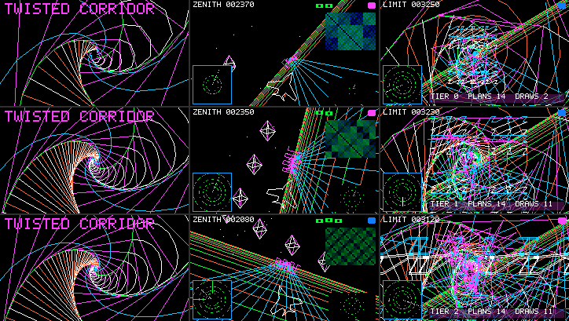

# MEGADEMO Act II — 上限を叩く場面と実機で決めた負荷

吸収した旧文書: megademo-limit-scenes.md（host での設計と上限の使用率）、megademo-device-limits.md（実機の測定と `KN`/`LOAD` の決定、場面切替の最初のフレーム）。どちらも JS（`apps/kasane/megademo_act1.js`・`proc_megademo.js`）のコメントが引くので、旧パスには移動の案内だけを残す。

対象は [apps/kasane/proc_megademo.js](../../apps/kasane/proc_megademo.js)（APPS の MEGADEMO、`local.megademo`）。Act II は 2026-09-29 に TWIST（ねじれ廊下）・ZENITH（Apple II 風ベクタ 3D）・LIMIT（両者を上限まで重ねる）を足したもの。数値は host か実機かを各所に書く。美的な評価はしない。

> **2026-10-27 の改訂**: 物語の器（部屋・猫・章立て・場面のつなぎ）を被せ、場面 LOST を足した。ZENITH のレーダーの縮小画像と munching squares（`pixel`）はメモリのために外し、TWIST に星の plan を 1 本足した。台本は [docs/apps/megademo-story.md](../apps/megademo-story.md)。
>
> **2026-10-28 の改訂**: LIMIT は場面ごと外し、正二十面体の殻が開く CORE に差し替えた（plan 7 本、HEAVY で線分 264・ラスタ 14,210）。上限を叩く役目は無くなった。**そのため LIMIT の上限使用率の表・場面×段階の統計表・`KN` の LIMIT 列と、ZENITH の縮小画像・`pixel` の記述は、この文書から落とした**（旧版はリポジトリ履歴）。以下の「決めた値」は 2026-09-29 の実機で決めたもので、LIMIT 以外の理由と手順は今も有効。

## 1. 結論

- **統合直後の MEGADEMO は実機で ZENITH に入ったところで止まっていた**（§2）。直したのはアプリ（JS）だけで、ネイティブの仕様は変えていない。
- 起動時に面0・面1のフレーム 5 枚（51 KB）を確保し、plan の読み込みを「1 フレーム 1 本・空き heap 22,528 B 以上の間だけ先読み」に変え（§4）、手続き面の回転読み出しを段階の負荷にした（§5）。
- 決めた段階での実測（通常 image、KASANE_PAINT 30 フレーム窓の fps、実機）: HEAVY は TWIST 29.8／ZENITH 19.7、MID は 29.9／29.9、LIGHT は 29.7／29.8。LIMIT（当時）は 22.5／24.7／26.9 fps で、描画量ゼロでも固定費（HUD の合成約 13 ms、JS の frame() 約 8 ms、LCD 転送 7.4 ms）で約 28 ms かかり 30 fps に届かなかった。
- **既定は HEAVY のまま**（測った範囲で最も重く、かつ安定: 6 周 2,237 フレームで DEGRADE・OOM・runaway なし、最長ターン 57 ms、ターン内の最小空き heap 6.8 KB。代案の MID は「30 fps 近くを保つ最も重い段階」だが、ストレステストの性格を優先した）。
- 仕様上限（線分・ラスタ・ステップ）は時間より先に効いた一方、**plan 32 本と 2 面は、メモリが先に尽きて仕様上限まで使えなかった**（§3）。

## 2. 実機で ZENITH に入ると止まった（記録）

面1（レーダー）の最初の `beginFrame(color, surf1)` が候補・確定フレーム 2 枚（各 10,246 B の連続領域）を確保できず `frame allocation failed`。`DEGRADE` で段階を 2 回下げてもメモリは減らないので、LIGHT で例外のまま終了した（通常 image で 3 回、診断 image で 1 回、すべて同じ）。空きは 43 KB（43,204 B）あったが最大連続領域が 15,872 B で、2 枚目が入らなかった。**host 検査はネイティブ heap の断片化を見ていない**（host だけで済んだことにしない例）。

対策は起動時に面0・面1のフレーム 5 枚（51 KB）を確保すること（`beginFrame` を描かずに 2 回呼ぶだけ。まだ 10 KB の穴がある時点で取る）。起動直後の空きは 96 KB → 39 KB に下がるが、以後は動く。`DEGRADE` は負荷を下げるだけでメモリは減らさないので、メモリの失敗は救えない。

## 3. 破綻の境界（実機の実測）

| 境界 | 実測 | 何が先に尽きたか |
| --- | --- | --- |
| plan の同時数 | 1 フレーム 1 本で旧・新を全部共存させると、TWIST 7＋ZENITH 16＝23 本でターン内最小 920 B、ZENITH 16＋LIMIT 先読みで同時 24 本目（空き 10,844 B、最大連続 1,088 B）、DEGRADE 後の再試行で 25・28 本目の確保が `plan allocation failed` → 終了 | ネイティブ heap。**仕様の 32 本より先に 24〜28 本目で尽きる**。登録のフレームはターン内で heap を中央値 4〜9 KB、最大 14.6 KB 余分に使う（JS の解読で作る配列） |
| 切替フレームの登録 | 先読みを同時 20 本で打ち切り、残り（最大 10 本）を切替フレームで一度に登録した試作（4 本/フレーム）で JS 208 ms、フレーム間隔 250 ms | 時間。frame() の runaway 監視（250 ms）の手前 |
| 回転読み出し | ZENITH HEAVY の回転なし／レーダーのみ／縮小画像のみ／両方 = 28.7／18.7／18.4／12.6 fps、帯の再描画 56／778／868／1,367 回/フレーム | 時間。帯キャッシュ（8 行 1 本、両面で共有）を回転した読み出しが毎行取り替える |
| ゲスト heap 上限 | 144／136／128 KiB は評価も 1 周も通過。124 KiB は評価は通るが ZENITH→LIMIT の切替で OOM（used 126,968 B）。120 KiB は評価で OOM（used 122,828 B） | 実機で要る上限は 124〜128 KiB（host の最小 123,125 B と整合）。160 KiB に対し 32〜36 KiB の余裕 |
| fps の下限 | 15 fps（間隔 66.7 ms）を破綻とみなした | 両回転の ZENITH（12.6）などがこれを割った |
| 面 2 | 2 面目のフレーム 20.5 KB（計算） | **メモリ**と**時間**（回転読み出し 23 ms/個） |
| 表示待ち候補 | 全面で 1 枚。面1（レーダー）の更新は 4 フレームに 1 回で、そのフレームは面0が止まる（[surface-segment-cap.md](surface-segment-cap.md)「第2手続き面」） | 仕様。ネイティブは変えていない（人の目で止まりが見えるか確かめてから判断） |

破綻の判定に使った基準: fps 中央値 15 未満、1 ターン 125 ms 超（runaway 250 ms の半分）、ターン内最小の空き 4 KB 未満、DEGRADE・OOM・起動失敗、キーが次のフレームに渡らない。

上限の host 検査（`run_proc_megademo_scenes.py`、v2.0 で削除）では、線分 1,024・ラスタ 8,192/draw・ステップ 10,000/draw などを 96〜99% まで使えることを確かめた（LIMIT 当時、host）。ラスタ上限はメモリを使わないので、緩める候補として最も安い。

## 4. plan の読み込み（`LOAD = [16, 1, 22528]`）

切替の 16 フレーム前から、1 フレーム 1 本、`pocket.memory.info().internalFreeBytes` が 22,528 B 以上のときだけ次の場面を先読みする。切替フレームで旧場面の全 handle を `unregister` し、残りは場面の最初のフレームから 1 本ずつ登録する。未登録の plan の draw は飛ばす（その間、層が 1 つずつ現れる）。段階変更（UP/DOWN）と `DEGRADE` は先読み中の集合も外してから入れ直し、LEFT/RIGHT は先読み中の集合が目的の場面ならそれを使う。

- **1 フレーム 1 本にした理由。** 時間の大半は JS 側のプログラムテキストの解読だった: `prog()` 104 本で 3〜35 ms（中央値 12 ms、1 命令あたり約 0.54 ms）、`register()` のネイティブ側は 1 本あたり中央値 0.83 ms（最大 1.5 ms、120 点の点列付きで 4.3 ms）、`ksn_proc_plan_prepare`（解析のみ）は中央値 0.19 ms。host（x86）の同じ QuickJS では 1 本 36 µs 程度で、実機との差は約 360 倍。ネイティブ→JS のコールバック（`split(',').map(f)`）は 1 回約 5.7 ms と特に遅く、JSON.parse ベースの解読に替えても 466→602 ms/37 本と遅くなった。旧方式（6 フレーム前から 4 本ずつ、切替時に残り全部）は成り立たなかった。
- **22,528 B の根拠（計算）。** 登録フレームの余分な heap 使用は最大 14.6 KB、空きの標本は最長 100 ms（3 フレーム）古いので最大 3 本分（約 3 KB）行き過ぎる。22.5 − 3 − 14.6 ≈ 5 KB がターン内に残る。実測のターン内最小は 6.8 KB（HEAVY 6 周）。
- **`pocket.memory.pressure()` の FREE ビットは使わなかった。** 24 KB 未満で立ち 36 KB 以上が 500 ms 続くまで下りないので、ZENITH を一度通ると以後の先読みがすべて止まった（実測）。
- **副作用。** 2 周目以降の最初の NEWS は最初の 5 フレームが部分描画になる（Act I の C 参照との一致は起動直後の 1 周目で成り立ち、試験もそこを見ている）。ZENITH は 7〜11 フレームが部分描画。旧・新を全部共存させる設計はメモリで、切替時に一度に登録する設計は時間で成り立たず、1 本ずつは両方の境界の内側に入る唯一の形だった。
- **登録の時間の残り。** 登録した 1 フレームの JS は中央値 20 ms、最大 57 ms。

## 5. 段階 `KN` と回転

負荷の値は `KN`（段階ごとの行）と `LOAD` の 2 か所だけにある。`q` は [ZENITH のレーダー, 縮小画像, LIMIT のレーダー] を回すか。**回転は描画量ではなく読み出し方の負荷だが、実機では最も大きい単一の費用（回す面1の画像 1 つにつき帯の再描画が 1 フレーム約 780〜870 回・約 23 ms）で、fps の下限を決めていたので段階に含めた。** HEAVY でも 2 つ回すと 12.6 fps で下限を割る。

| 段階 | 決め方 |
| --- | --- |
| HEAVY（既定） | 15 fps を割らない最重。TWIST は n 26 r .8 m 3 s 8 D 6、ZENITH は 60, 14, 15, 3×8, 4, 16, 4、回転は ZENITH のレーダーのみ |
| MID | TWIST・ZENITH は HEAVY と同じ（HEAVY の負荷でも表示レート 29.9 fps を保つため共有）。回転なし |
| LIGHT | 全場面で 26.9 fps 以上、TWIST の仕事 24 ms（表示周期まで 9 ms）。回転なし |

n は廊下の奥行きの枠数、r は 1 枠ごとの縮小率、m は 1 枠あたりの横木、s はアーチの分割、D はねじれの最大（ラジアン）。転送は全画面 64,800 B で 7.3〜7.4 ms、表示周期は 33.3 ms なので、TWIST と MID/LIGHT の ZENITH は表示レートで頭打ち（29.5〜29.9 fps、実機）。

## 6. 周回とメモリ（実機の実測）

HEAVY 95 秒（2,237 フレーム、約 6 周、plan の登録 327 回）: 2 周目以降、各周の頭の空きは 35,892〜35,904 B、最大連続 7,680 B で一定。ゲスト heap も周ごとに同じ値（106,732〜106,744 B）に戻った。**周回で減り続ける成分と、断片化で最大連続が縮む傾向はなかった。** ゲスト heap（malloc_size）はターン境界の最大 112,432 B、起動直後（評価後）は 100,696 B でそのときの空きは 39,368 B・最大連続 12,800 B。Back から `APP_STOPPED` まで 62〜188 ms（host の時計、USB 往復込み）で、終了後の空きは起動前と同じ 221,516 B。入力は届いたターンの frame() に渡り、キー書き込みから `MEGADEMO SCENE` のログまで 47〜63 ms。

## 7. 場面切替の最初のフレーム（2026-09-29、実機）

ユーザーの観察「2周目以降の NEWS の冒頭数フレームで旧い HUD が一瞬表示される」を調べた。

- **メニューから起動した MEGADEMO では、仮説の機構（frame() が plan の登録で予算を超えて park し、commit 済みの新画像と未 replace の旧 view が重なる）は起きない。** HEAVY 95 秒・2,228 ターンで park 0。ソースを渡して起動するアプリは `app_session.c` の `FRAME_WRAP` を通り、本体が `Function.prototype.apply` からのネイティブ再入の床で走るので止まってよい床にならない（[vm-L2-design.md](../vm/vm-L2-design.md) §11.2 D17r、§11.9）。LIMIT→NEWS 直後に送った画素に HUD は無かった（強制再描画あり・なしの capture で確認）。パネルの残像は候補だが未検証（MISO 未配線）。
- **代わりに、場面の最初のフレームが `build()` の既定値のまま表示される不具合を直した。** replace のフレームでは `patch()` が呼ばれず次のフレームで初めて場面の状態になっていた（全画面で TWIST に入ると 1 フレームだけ全画面の画像とタイトル全文が出る、小窓だと隠れているはずの HUD が 1 フレーム出る）。修正は `V.replace(tx => (build(tx), patch(tx, f)))`。ソース +189 B、ゲスト heap 最大 +368 B、切替フレームの間隔は最大 63.7 → 77.7 ms（場面の最初のフレームで plan を 1 本多く描くため。125 ms の内側）。
- **park できる経路では機構が実在した**ので、plan の登録を `beginFrame` の前（場面の切替の直後）へ移した（診断起動 `'J'` で commit 後・replace 前の表示 136 回、うち場面の最初のフレーム 17 回 → 移した後は最初のフレームで 0 回）。メニュー起動では park しないので現状は表示を変えない。登録を `replace` の後ろへ置く案は、`try`/`catch` を 2 つに分ける必要がありソース（= ゲスト heap）が増えるので採らなかった。

## 8. ゲストヒープ（host の計数と実機）

評価（コンパイル）時のピークが律速。device と同じ課金（TLSF 長、m32）の host で、評価と 1,136 フレームが通る最小の上限は **123,125 B**（上限 163,840 B の 75%、当時の 26,986 B のソース。変更前の 10,802 B のソースは 74,453 B）。QuickJS は参照カウントで即時解放するので GC 前後のピークは同じ。実機では 124〜128 KiB が要った（§3、実測）。下げた手順（いずれもプログラムと画素のハッシュが不変）:

1. plan のプログラムを**テキスト**（1 文字＝1 opcode）にして、デコーダ `prog()` 1 つで配列へ展開する（生成関数とアセンブラの 17 個のクロージャが消えた）。
2. 先読み中に場面の全プログラム配列を保持していたのを、plan ごとの thunk にした。
3. テンプレート文字列の実行時連結をやめ、view の Act I セットをデータ配列＋ループにした。

## 9. 場面の設計の芯

**TWIST — ねじれ廊下。** 構成は単純なのに身体と空間のモデルが壊れる、というギャップ。規則は 1 つ: 廊下の断面（矩形）の各点 P を、1 フレーム奥へ進むごとに複素数 z = r·e^{iδ} 倍する。r < 1 が遠近（割り算の無い IR で透視が作れる）、δ がねじれ（場面の間に 0 → 最大 → 0）。前進は入力側で z^{−φ} を掛けるだけで連続になり、φ が 1 を越えた瞬間は「1 つ奥の枠が手前へ来た」状態と一致する（継ぎ目がない）。床・壁の段・天井のアーチ・手すり・枠はどれも「断面の点を z 倍し続ける」同じ規則の別の点。IR では複素積の 7 命令を展開し、枠の plan は 63 命令・16 レジスタ。

**ZENITH — Apple II の解釈。** *Zenith* は 1982 年の Apple II 用アクションゲーム（Nasir Gebelli）で疑似 3D の宇宙シューティング、自機を左右に回転（ロール）できるのが特徴、という点までしか確認していない（MobyGames と Internet Archive）。作品の再現ではなく解釈で作った: 色は Apple II のハイレゾ 6 色相当（黒・白・紫 `0xfa3f`・緑 `0x17a7`・青 `0x167f`・橙 `0xfb47`）、3D は塗らずに線だけ、ロールは VM 内で地平線の基底を回して表す（画像回転に頼らない）、地面は地平線に平行な横線の束（`REPEAT_REG`、緑と橙を交互に `LINE_COLOR_REG`）、奥行きは車線・スカイライン・12 辺を 1 本の経路でたどる正八面体・`CUBIC` のレーザー・ロール角 8 段ごとに登録した自機の点列。面1にレーダー（`CUBIC` 4 本の円、掃引線、`PLOT_COLOR_REG` の輝点）を描く。

## 10. 使わなかった API とその理由

`mount`/`view.set`/`bind` は REPLACE/PATCH と同じ APP lease で混ぜない契約（[architecture.md](architecture.md)）。`createScene` は描画される内容が増えない。`tx.modal.open` は Enter と矢印の操作を保つため使わない（overlay では UNSUPPORTED）。`grid.*` は入力をゲストの配列で渡す面で手続き描画のストレスとは別、`grid.fold/index/view` は初回呼び出しで約 6 KB の JS フロントエンドをゲストに読み込む。`video.*` は JS から `push` すると 240×135 の 1 フレームで 64,800 B をゲストに持つ。`pocket.overlay` は FLOWER 背景の overlay 専用。`cache.release` は instance が表示から消えた後でないと呼べない（寿命の契約）。

## 11. 人が実パネルで確かめること

1. ZENITH の HEAVY（18.6〜19.7 fps）で、回転するレーダーとバレルロールが滑らかに見えるか。MID（29.9 fps、レーダーは回らない）との差。
2. 面1（レーダー）を更新するフレーム（4 フレームに 1 回）で面0が 1 フレーム止まるのが見えるか。見えるなら「表示待ち候補を面ごとに持つ」ネイティブ変更の材料になる。
3. 場面の頭で層が 1 つずつ現れる（ZENITH で 7〜11 フレーム、2 周目以降の最初の NEWS で 5 フレーム）のが気になるか。
4. Apple II 風の 6 色がパネルでどう見えるか、TWIST のねじれの錯視が 30 fps で成立するか。

## 12. 実機画像と host 画像

通常 image の `board_capture`（転送前の RGB565、135 行、MISO 未配線のためパネルそのものは読んでいない）。TWIST・ZENITH・NEWS は host 参照と全画素一致、LIMIT は中央の矩形（アトラクタの紫を含む画素）だけ 723〜2,170/22,644 画素が違い、実機（newlib）と host（glibc）の `sinf` の末尾ビットの差をカオス写像が増幅したと推定している（未検証）。LIMIT は 2026-10-28 に外れたので現行の画ではない。host の描画は [合成パネル](megademo-act2-host.png) と [TWIST の 16 枚](megademo-twist-host.png)。

## 13. 判断のまとめ

- **ネイティブを変えなかった。** 面1の確保失敗は起動時の確保で、plan の同時数は読み込み方式で、どちらもアプリ側で避けられた。帯キャッシュを面ごとに持つ変更（+3.8 KB）は回転そのものの取り替え（1 つの面の中で行ごとに帯をまたぐ）を減らさないので効果が薄く、メモリは最も足りない資源なので見送った。
- **Act I を残した。** 既存の 48 フレームの C 参照・実機ハッシュとの比較を壊さないため、Act I の programs/inputs は同一のまま。
- **host の `pocket.memory.info()` は実機のターン境界の空きに合わせた直線で代用する**（31,000 − 1,000×live B）。評価中の実機は `null` を返すので、host の台本も同じ値を返す必要がある（CLAUDE.md）。
