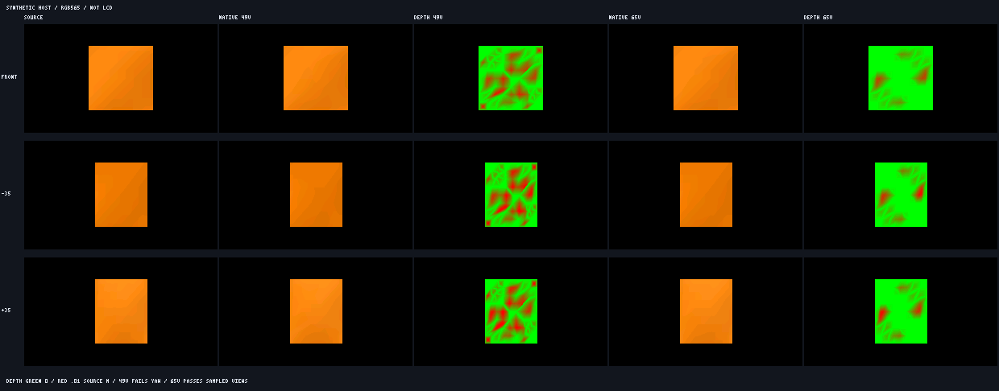

# Source縮小とnative最終画像の検証

状態: **人工meshのhost試験。Blender export、狐の造形、実機画質の受入ではない。**
2026-10-31。製品renderer/既定FOX FACE/FOX SHEETと実機023559fは変更していない。
[制作pipeline設計](../api/ayatsuri-asset-pipeline-draft.md) / [実行手順](../../tools/ayatsuri/asset/README.md)。

## 何を比較したか

原本はGLBの編集可能な81頂点・128面の人工曲面grid。高密度IRを固定したまま、
endpoint QEMによる49/65頂点の候補を自動生成し、同じ誤差・資源ゲートへ通した。
POSITIONには実F32のmin/maxを含める。初期fixtureのbounds欠落は適合性の誤りとして修正し、
local matrixの不適合なshear正例も、有効なTRS階層によるglobal shearへ置換した。
これらはGLB入力・試験器の修正で、geometryのAYNM内容を変えたものではない。
曲面形状の係数を調整して通したものではなく、縮小後の保持頂点数を比較している。
資産はAYNMの固定mesh/material/topology、Instanceは通常のnative評価を使う。

source oracleはF64でsource面を投影し、各pixelで最も手前のsource三角形を求める。
照明はsourceに明示したHone材質mappingをF64で頂点評価し、RGB565へ量子化してGouraud補間する。
比較相手は実 `ayatsuri_model_instance_evaluate` → 既存packet →
`ksn_proc_render_band` の最終RGB565画像。SNORM normal、F32、頂点shade、補間の損失を含む。
BlenderのPBR画像や実LCDを基準にした色差ではない。

sourceとnativeで同じcamera、世界光、root pose、assetScaleを使う。
240×135、正射影、黒背景、Hone40 units/source metre、正面camera `[0,0,400]`、
target `[0,0,0]`、zoom1、中心 `[120,67]`。
固定世界光 `[-.5,-.4,.8]`、light RGB `[1,1,1]`。
yawはcameraだけ±35°、光だけの比較は `[.6,-.2,.75]`、
身体だけの比較はrootのY回転0.2 rad。正面の再実行はpixel/tag/coverageのbyte一致を確認する。

## ゲートと対応の証拠

- silhouette IoU ≥.97。
- 最終色はR5/G6/B5**各成分別**に絶対code差のmean ≤.5 / p95 ≤1 / max ≤2。
  RGBをpoolした平均も参考値として記録するが、合否には使わない。
- source単位のdepth差と対応点距離は最大.01。この人工sourceの幅は2なので幅の.5%に当たる。
  この値をサイズの異なる狐へ無条件に適用しない。
- semantic/source componentの取り違え0、未知tag0、tagのtriangle外pixel0。
- sourceの最前面が同depthで曖昧な場合は初版では拒否。
  `depthTieEpsilonSource=1e-6`。tieを正しい遮蔽として黙認しない。
  ただし同じsource面の共有vertex/edge上にある実hitは同一の物理featureとして扱い、比較からは除外しない。
  第三の面を含む全ray hitを調べ、単にcomponentが同じという理由では許可しない。
  attribute seamでindexが分割された共有edgeは保守的に拒否し、実資産で未検証とする。

native画像にはZ-bufferを追加していない。別の診断passで各実triangleを一意なRGB565 tagに替え、
実際のpacket/triangle順と同じ順で同じrendererへ描き、pixelの可視triangleを追う。
通常colour frameは通常の1024 segment/raster上限内で一括提出する。
診断tag passの1triangle frame再利用は、製品のquota/速度を証明する方法ではない。
white coverageとの一致に加え、全native被覆pixelのtag存在とtriangle内/top-left判定も検査する。
probeの9桁十進F32出力は検査前にF32へ戻し、境界判定へ十進doubleの誤差を混ぜない。

各pixelの記録はsourceSurface/元triangle、native node/tag、cold triangleの元lineage、
元vertex anchor、source component、depth差、対応点距離を持つ。
再三角形化では元triangle IDの単純一致を要求せず、連結領域と3D対応点を比較する。
同じsemantic IDだけ、同じ色だけ、nearest geometry距離だけで前後順を合格にしない。

## 候補比較

以下は人工sourceのhost観測値。総guest peak・ESP heap・FPSではない。
source/view/光/閾値を固定し、49頂点版のFAILを残したまま65頂点版を選ぶ。

| 縮小候補 | cold | Instance arena | segment上限 | native view域 |
| --- | ---: | ---: | ---: | --- |
| 49 vertices | 2640 B | 3116 B | 137 | yaw ±35°でdepth/correspondence FAIL |
| 65 vertices | 3656 B | 4580 B | 200 | 固定した全6 caseでPASS |



各paneは240×135のまま。列はsource参照、native49、49のdepth差、native65、65のdepth差。
行は正面、camera yaw−35°、+35°。depth色は緑0から赤.01 source metre。
これはhost simulation画像であり、実機captureや狐の設定画ではない。

Instance arenaは64bit C probeの値。JS wrapper、描画snapshot、frame/作業buffer、
probe専用画像buffer/BSS/stackを含む全体RAMではない。m32/実機peakは未測定。
65頂点版の増分はcold +1016 B、arena +1464 B、segment +63。
限界を引き上げたり、強制GCで通したりしていない。

49頂点版は正面depth最大約.0095703で通るが、yaw−35°で約.0113514、
yaw+35°で約.0117380となり、.01を超えた。色とIoUは通っても受入不可と判定した。
65頂点版の観測最大depthは約.0097274、最終色の最大差は1 code、IoUは全case1。
この観測最大は指定camera/光/poseのsampleであり、連続全角度域の数学的保証ではない。
縮小しない81頂点の対照では、depth差は約3e-9、色最大差1 codeだった。

## 負例で確認した見逃し

| 負例 | 結果 |
| --- | --- |
| 同semantic・同色の前後二面を逆順描画 | colour/silhouetteが同じでもdepth .5を検出 |
| 一つのsourceSurface内の前後二面を逆順描画 | 同じsource IDでもdepth .5と対応領域差を検出 |
| 被覆tagを近側の一つのtriangleへ潰す | 1240 pixelのtriangle外tagを拒否 |
| source外1 pixelにcoverageと未知tagを追加 | IoUだけでは通る差でも未知tag1を拒否 |
| 全被覆pixelのGを+1 code | pooled平均1/3で隠さず、G成分mean1で色gate FAIL |
| 全被覆pixelのGを+4 code | 色gate FAIL、depthは維持 |
| retained metadataのJSON数値1e999 | import時に非有限数として理由/path付きで拒否 |

最初の検証器はtagのbarycentric外挿とsource外未知tagを見逃したため、独立レビュー後に修正した。
これは製品rendererの欠陥を発見したという意味ではなく、受入証拠の偽陽性を閉じたもの。
G成分のpool平均も仕様案と違っていたため、各成分gateに合わせた。

## 再現と未完

```sh
python3 tools/ayatsuri/asset/verify_pixels.py --output-dir .cache/asset-pipeline/native-study --asan
python3 tools/ayatsuri/asset/contact.py .cache/asset-pipeline/native-study .cache/asset-pipeline/native-study/contact.png
```

既存Linux/WSL・gcc・Nodeを使用し、新software導入・SDK・実機は不要。
新しい出力directoryを指定する。input/bin/source/画像SHA、compiler flags、
全caseの誤差/gate、負例結果、対応のpixel例、source不変を保存する。
native画像の読取りはbin hash、全出力hash、現在のnative source hashも照合する。
途中FAILや過去headの成功を、別のheadの合格へ流用しない。

Blenderは限定探索で未発見だが、不存在とは断定していない。
高自由度の狐sourceも未制作で、[制作工程案の§11](../api/ayatsuri-asset-pipeline-draft.md)から進める。
実Blender export損失、狐の造形、morph、clip、一般的な交差形状、実機RAM/画質/FPSは未受入。
人工sourceで全gateが通っても製品既定へは自動採用しない。

## 独立照明・証拠保護の後続修正

参照照明は要求されたlight 6要素とcameraから独立計算するview方向を使う。
native evaluatedLightingをそのままsource参照へ流用しない。evaluatedLighting自体は
別gate（最大絶対差1e-6）で比較し、producerが保存する要求camera/light/rootPoseと
metadataのechoも照合する。別光で描かれた実C画像に本来の要求光を与える負例では、
照明と最終色の両gateが失敗し、geometry/depth/correspondenceは維持されることを確認する。

単独oracle CLIも新規directoryを排他的に予約する。既存oracle.json/PNGを上書きせず、
失敗後の予約先を次実行の成功成果物に見せかけない。負例用readerは本体loadNativeを共用し、
sourceSha256欠落・空・staleを含む同じprovenance規則を適用する。
これらの回帰はtest_oracle_cli.cjsをCIから明示実行し、freshな実C studyも使用する。
