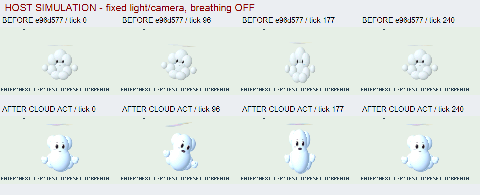
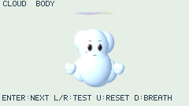

# CLOUD ACT: 雲1体の造形・演技の縦断改善

2026-10-30。改善前のapp sourceは`e96d577c4e7e0cb298cda2b8a51f39350613eefa`。このheadの72 CI成功は診断機構までの結果で、以下の新しい造形/primitiveの合格へ流用しない。設定図の実画素を見て[雲の目標と変更点](../../apps/cloud/README.md)を具体化した。

## 視覚証拠 — HOST SIMULATION

動画はAPNG。ビューアが静止表示する場合は元PNGをAPNG対応ブラウザで開く。rawの240×135画像を加工せず連番化し、Description metadataにもHOST SIMULATIONと記録した。比較一覧だけは条件ラベルを画像の外側へ加えた。

前後とも同じcamera/light/背景/呼吸OFF/論理tickでnative host rendererを使う。前はe96の6つのchunk/entryをgitから抽出し、current nativeの互換ellipsoid経路で実行。新packed endpointは前のappでは使わないため、失敗注入先を一致させるbaseline wrapperで無効化した。BODY tick82は以前のe96 captureとRGB hashが一致した。前を別の実機firmwareで撮影した比較ではない。

変えたのは、球ごとの前面/alpha積層から共有前面への変更、大きな梨形と奥の周縁lobe、前面の大きな顔、独立した手/彩雲、視線先行・予備squash・上昇・遅れ・減衰settle。相互比較できるのは造形/演技の候補であり、参照への到達や実機の材質品質を合格としない。

独立目視では中央の縦筋が減り、顔/手/彩雲と動作の段階差が読めることを確認した。一方、滑らかな豆/雪だるまに寄る主形、周縁の丸いpuff境界、小さな楕円形の口、直線状に近い彩雲、微細な雲の密度と柔らかな透過がなお不足。ここを次の造形/材質の改善対象とし、診断機構を増やすことを成果の代用にしない。

## 実装と資源の判断

独立ellipsoidのopacity調整だけでは内部の境界陰影が消えなかったため、[汎用の前面ブレンド](../api/blended-surfaces.md)を追加した。陰影を固定textureへ焼かず、形状/法線・世界光・視点を入力にする。ambient RGBは青い空の環境光の様式化で、方向光/透過項とは別。物理的な面光源/体積散乱の解法ではない。

新しい雲/演技/geometry codeを3体labへ全部常駐させた初稿はm32/163840 Bで初frame失敗。雲専用appへ切り分け、既存labを保持し、blendも任意moduleとした。共通utilityのforkは作らない。それでもheader費用で余裕が足りず、packed入口で通常楕円体のtyped viewを減らした。shape/部品/上限を削って通したのではない。

packedの互換viewは旧backend/visit初回だけ生成する。独立レビューで部分確保後の再試行不能を発見し、4個をlocalへ確保してから公開するよう修正。各確保点の失敗→再試行をテストした。

## ローカルhost観測

| 試験 | 結果 |
| --- | --- |
| standard3lab m32、163840 B、強制GCなし、全描画reference | 5418 frames、例外/提示失敗0、OOM切替後再生成・6種range復帰・guest解放後0。compile peak101380 B、malloc_size最大151364 B、fixture allocator peak137304 B、単一要求load10912/run1571 B |
| CLOUD ACT m32、同条件 | 1806 frames、全6mode、停止240/300一致、例外/提示失敗0、range復帰・解放後0。compile peak104424 B、malloc_size最大159148 B、fixture allocator peak144888 B、単一要求load8316/run1571 B |
| cloud ASan/UBSan64 capture | 4条件/逆seek/評価・render・commit注入失敗の旧画像保持と復帰・差分全描画一致・解放後0、PASS。無制限heapの診断試験 |
| BODY連続画像 | tick0..300、301枚。停止240..300の61枚は全RGB hash一致。sample位置の検証で、実機の連続表示やFPS測定ではない |
| packed/native | 旧API画素一致、整列/未整列span、padding無視、caller変更後snapshot不変、型/範囲拒否。blendの連続前面/ambient色/深度/単一alpha/packet全parameter署名/repairと既存ellipsoidをO0/O2 ASan/UBSanで照合 |
| registry/utility | 新appを末尾へ追加。registry129 checks、既存app-control、utility/Node lab、入力plan5testsを確認 |

ログは`.cache/cloud-final-character-m32.log`、`.cache/cloud-final-dedicated-m32.log`、`.cache/cloud-final-asan.log`、`.cache/cloud-quality-{packed,motion,before,motion-final}/`。source hash/binary hash/dirty情報は各captureのmanifestにある。上記m32値はlazy互換viewの原子的公開修正後に再実行したもの。301枚も修正後のsourceで再生成して全RGB hash一致を確認した。最終head CIは別に確認する。

上記guestの値をnative free/largest/stackへ読み替えない。最大group payload768 Bをコピーするbridge/renderer/walkerとprojection cacheはnative stackを使う。構造体sizeを単純加算してstack peakとせず、実機で別測定する。新候補の物理LCD、実機repair、操作応答/時間/最小free/largest/stackは未確認。
