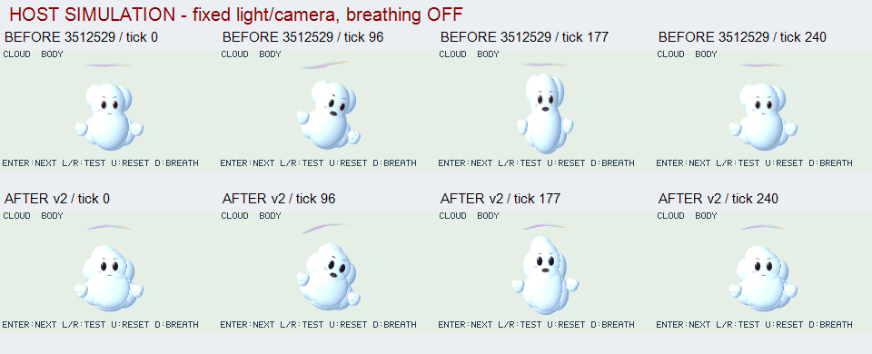
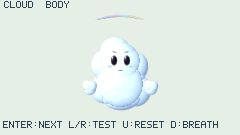

# CLOUD ACT: 顔の比率を保つ胴体変形

2026-10-30。比較元は実機機能smoke済みの`3512529b6f47a609b8041833f9c7e8e0bccb6ccc`。[前候補のCI/実機記録](cloud-quality-v1.md)はそのSHAの結果として保持する。本変更の実機書換えは行っていない。

## 同条件の視覚比較 — HOST SIMULATION

240×135のnative host描画を同じ時刻・光・視点で比較。上段は3512529の301枚、下段は今回の301枚から抽出。連番は元RGBを加工せずAPNGへ格納し、CRC/順序/全frameのRGB hashをmanifestと照合する。条件ラベルだけを描画領域外へ追加した。

## 実装と判断

- actorは一様倍率と剛体移動を所有し、胴体volumeだけを伸縮。顔は胴体表面へ平行移動し、頭の回転と縦横比を保つ。浮遊手も伸縮から独立。単に顔を逆倍率にすると回転時にせん断を生むため、親から非一様scaleを除いた。
- 胴体は8つの大小lobeへ再構成。肩と裾を広げ、頭頂を幅広く奥へ寄せ、前面blendを12 world unitsへ調整。固定陰影textureを足す方式ではなく、法線/陰影/透過近似は形・世界光・視点から評価する。
- 瞳を大きくし、白い身体上で重複していた白色eye-rimを省いた。顔の可読性と通常描画の資源を両立する変更で、heap上限は据置き。
- 彩雲は5つの薄い形に弧と局所傾斜を与える。中心→左右端が0/80/160msの差で応答し、反動と収束を解析的に評価。追加入力`wispCenter/Left/Right`はモデルのローカルY差分。honeに雲固有処理を追加せず、tick240以降は全て0へ戻る。

伸長時に顔が細長くなる問題は変換契約と画像で改善。裾の広がり、彩雲の弧と左右の違いも読める。一方、滑らかな表面、丸い頭頂、青い境界筋、細い彩雲、口の表現幅は設定画へ未到達。体積密度や柔らかな散乱を再現したとはしない。

## host検証と資源

| 条件 | 観測 |
| --- | --- |
| m32/SSE2、heap163840 B、強制GCなし、6mode×301 | 1806 frames、例外/提示失敗0、差分と全描画reference一致、repair注入と6種native range失敗復帰PASS、終了guest0 |
| 同試験の資源 | compile peak104968 B、QuickJS malloc_size最大156956 B、fixture allocator peak143044 B、最大単一要求load8316/run1571 B |
| 3512529の同条件値 | compile peak104424 B、malloc_size最大159148 B、allocator peak144888 B。差はモデル/演技/部品構成も含み、API単体の最適化量ではない |
| 変換回帰 | stretch .84/1/1.19、頭・身体の回転あり。顔/手/各顔パーツの世界軸倍率.9、直交性、胴体のみ幅/高さ変更を確認 |
| 演技回帰 | 正逆seek、入力順独立、彩雲の段階差/反動/有限範囲、tick240/300の厳密な停止。Node app273 commits PASS |
| ASan/UBSan64 BODY capture | 301枚、逆seek/評価・render・commit失敗の画像保持と再開、全描画照合、guest解放PASS。無制限heapの診断でありm32上限の代用ではない |

初稿の追加groupと白eye-rimを残す構成は163840 Bで初frame失敗した。胴体volumeへ直接scaleを適用して余分なgroupを除き、目の構成を見直して上記条件を通した。失敗を隠す強制GCやheap拡大は使っていない。

raw画像・manifest・ログは`.cache/cloud-v2-motion-final/`、`.cache/cloud-v2-motion-final.log`、`.cache/cloud-v2-m32-final.log`。fixtureは既存native binaryを再利用し、app chunkは実行ごとに読む。manifestに各chunkのhashとdirty状態を記録。最終headのCI・製品linkは別に確認する。host時間や静止画像から実機FPS/材質受入を推定しない。

## 遅いrender窓の切り分け — 基準3512529のみ

Astra担当が3512529のappとnative rendererへhost用の無変更/計数版を用意し、固定15姿勢でASan/UBSan実行。両版の全15画像のpixel FNV32は一致。STILL tick0の全描画では、予算上のlobe訪問33168、被覆hit7514、陰影評価4441、powf4192、描画した固有pixel3886、重複write552。うち7-lobe胴体はbbox4408×7訪問、被覆hit6239、陰影3420。15姿勢全体では訪問32002–35920、陰影4363–4485だった。

これは計算回数の観測で、deviceのmsではない。実機の7個の30-frame窓と同じframe/bandを対応させていないため、render15.57–108.52 msの差の原因は未特定。既存band_cyclesは背景fillとnative band描画、span_cyclesはその処理を含む外側であり加算しない。現段階でPIE採用や高速化済みとはしない。再現用helper/出典hash/集計は`.cache/cloud-workcount/{probe.py,provenance.json,counts.json,counts.csv,base.log,count.log,run.log}`。本変更の8-lobeモデルへこの回数を転用しない。
