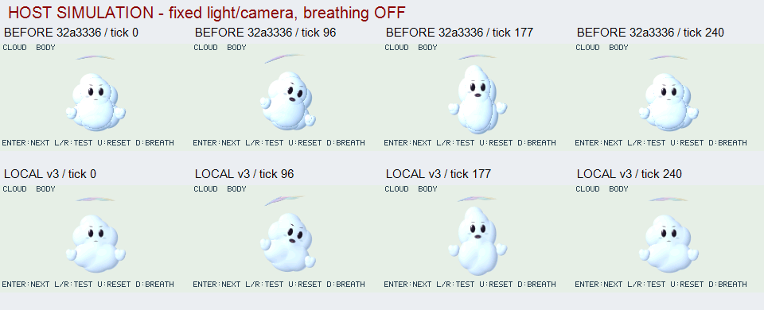
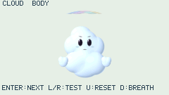
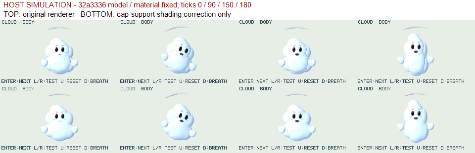

# CLOUD ACT: cap境界の陰影と柔らかな量感

2026-10-30。今回の範囲はローカル3D改善と独立レビュー。基準`32a333698b98db490adbd63644b010d3dab5b2d0`は[72 CI成功](https://github.com/dj-oyu/cardputer-adv-pocketjs/actions/runs/41025820980)の公開候補。以下は別の変更であり、そのCI/実機結果を流用しない。実機操作、画像パーツ方式の実装はしていない。

## 同条件比較 — HOST SIMULATION

基準の301枚と今回の301枚を同時刻/同入力で比較した。APNGは240×135の元RGBを加工せず格納し、全301枚のRGB hash、CRC、順序、delayをmanifestと照合。比較一覧のラベルだけを描画領域外へ追加している。

## 原因と仕様へのフィードバック

前面深度のsmooth-maxでは、新しい楕円体capが入る際の重みが有限でも、cap縁の高さ勾配は発散する。その法線を直接混合すると、連続したbody内部が青い筋になる。再現fixtureでは、lobe中心を54.999↔55.001へ動かした際に同じ前面pixelが旧rendererで`0x3186↔0xffff`へ変化した。

複数lobeをblendする場合だけ、陰影法線と透過chordの寄与をcap内の残余`1-q·q`で減衰させ、chordを寄与量で正規化した。修正後は上記2位置とも`0xffff`。幾何深度/輪郭/coverage/単一alpha/描画順/packet所有権は変更しない。単一lobeとblend=0は補正を通さず以前の画素を保持する。

これは[近似陰影法線の契約](../api/blended-surfaces.md)の更新で、厳密なsmooth-max深度の微分法線や体積散乱ではない。低層にcloud専用分岐は追加せず、世界光/視線と形に応答する汎用描画のまま。更新依存や資源上限を増やしていない。

この分離試験は32a3336のモデル/材質を固定した15姿勢で実行。肩/裾の筋が消え、下側の青い陰影が残るため、全体を白くするだけの変化ではない。元renderer/試作/採用コードと入力hashは`.cache/cloud-seam/`の`provenance.json`、`compare.py`、`base.log`、`current.log`で追跡できる。

## モデル・材質・彩雲

材質だけをambient .88/diffuse .28へ寄せた対照案は筋を薄くする一方、中央を平坦にしたためそのまま採用しなかった。最終案はambient .82/diffuse .38、淡い青の環境色、specular0で、形の陰影を残す。腹部の主楕円を小さくし、左右の下部volumeを少し前へ出して、同じ8lobe内で大小/前後差を作った。

彩雲は5つの既存形状を交互の高さへずらし、中心→端の変位を二次曲線で補間、局所回転もその傾きへ合わせた。新しいnodeや時刻依存の乱数は追加せず、前候補の追従時刻/収束は保持。強く曲げて羽根や触角の形へ寄せる方式は避けた。

独立目視では青い継ぎ目/縁の減少、白淡青の連続量感、顔/手の比率保持、薄い層状彩雲の改善を確認。LIGHTのみで陰影位置、CAMERAのみで形の見え方が変化する。連続301枚の選択frameと停止hashを確認したレビューで、物理LCDや実機再生の受入ではない。滑らかな雪/マシュマロ感、頭頂の丸み、単純な口、彩雲の細い繊維状の空気感はまだ不足している。

## 検証と観測

| 試験 | 結果 |
| --- | --- |
| cloud m32/SSE2、heap163840 B、強制GCなし、全描画reference | 1806 frames、例外/提示失敗0、repair注入・6種range失敗復帰PASS、終了guest0。compile peak104952 B、QuickJS malloc_size最大156940 B、fixture allocator peak143028 B、最大単一要求load8316/run1571 B |
| 既存3体 m32、同条件 | 5418 frames、失敗0、OOM切替復帰・range復帰・終了guest0。compile peak101380 B、malloc_size最大151364 B、allocator peak137304 B、最大単一要求load10912/run1571 B |
| ASan/UBSan64 capture | 最終4条件＋BODY301枚、差分/全描画照合、正逆seek・失敗注入後画像保持/復帰、解放PASS。診断は無制限heapで、m32資源門の代用ではない |
| 停止/画像原本 | tick240..300の61枚は同一RGB hash。manifest内のapp source hashは最終ソースと一致、APNG301枚のRGB/CRC/順序/delay一致 |
| native O0/O2 ASan/UBSan | 単一lobe/硬いunion×前/横/後方光の旧画像hash6個一致。cap出入りとbacklight/chord連続性、ambientのみの全画素coverage hash不変、既存snapshot/repair/band/限界試験PASS |
| native分離試験 | 固定32a3336モデル15姿勢、ASan/UBSan PASS。採用コードの全15画像は試作と同じ画素。通常ellipsoidの描画式は変更なし |
| Node | app273 commits PASS。顔/手の世界比率、回転/非一様body変形、seek/割込み/停止の既存回帰を維持 |

ログ/原本は`.cache/cloud-v3-{m32,standard-m32,final,native-first}.log`、`.cache/cloud-v3-final/manifest.json`。native再現は`.cache/cloud-seam/{invariants.sh,invariants-base.log,invariants-current.log,current-run.log}`と追跡済み`test_proc_blend_ellipsoids.c`。guestの標本をnative free/largest/stackに読み替えず、計算量や実機msの改善は未測定。公開CI/実機結果は本ローカル候補では未取得。

## 後続相談の記録

別途相談中の画像パーツ/ワープ/陰影層による2.5Dは、着手する場合の最初の対象をキツネとするユーザー指定がある。まだ実装方式の合意ではなく、この変更へ含めていない。次の仕様検討では固有模様と陰影の分離、瞳/顎/鼻先の深度差、マスク境界と回転時の遮蔽、同じ世界光/視点での比較、JS/Cの同じ意味と所有権を検証対象として整理する。
