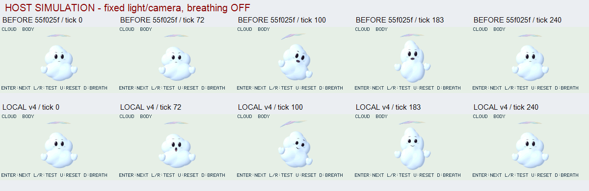
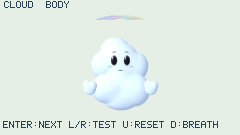

# CLOUD ACT: 喜びと驚きの読み分け

2026-10-30。基準は公開済み`55f025f2063eaf78341daeca968444cfd8bf204b`。[前反復](cloud-quality-v3.md)の継ぎ目補正・大小volume・世界光への応答を維持し、今回は表情と彩雲の演技をローカルで改善する。実機は別担当の32a3336のまま、本変更の公開CI/実機検証ではない。新API方式/2.5D/画像パーツは追加していない。

## 同条件比較 — HOST SIMULATION

同じ論理時刻/入力/240×135 native host描画で比較。元RGBを変更せずAPNGへ格納し、301枚のRGB hash/CRC/順序/delayを検証。比較ラベルだけを描画領域外へ追加した。

## 演技の契約と実装

- 気づき: 2.0秒から視線が先行。驚きは2.16〜2.78秒、2.30〜2.47秒に最大。縦長の丸口とピンクの内側、広くなる目、高く上がる眉を組み合わせる。
- 喜び: 2.90〜4.14秒と5.60〜6.75秒。`expression.smile`を喜び、新しいモデル内入力`expression.surprise`を驚きとして分離し、両者の有効区間は重ねない。横に広がる上向きの口角、上がる頬、細くなる目、驚きより低く柔らかい眉で読み分ける。
- 口は既存のmouth/tongueの2面を再利用。喜びでは同じ濃色の2本の丸いstrokeで上がる口角を作り、驚きでは暗いopeningとピンクの内側へ連続変形する。色/opacityも連続入力から評価し、新しいdrawable partは増やさない。
- 彩雲は既存の屈曲と別に、モデル内の0..1入力`wispSpreadCenter/Left/Right`で広がる。中心→左右端を0/100/200msずらし、曲率に沿う位置と幅へ反映。最後の端も7.05秒で基準へ戻る。全演技はtick240以後に厳密な待機状態。

既存bodyの予備動作/重心移動/圧縮伸長/手の遅れは維持し、固定世界光やvolume色を時間で明滅させていない。全入力は時刻から純粋に評価し、非BODY modeでは新入力を0へ戻す。sleepや前frameの累積状態は使わない。

## メモリ失敗からの修正

初稿は追加部品なしでも、部位別pose record/小配列と演技コードが増え、m32/163840 B/強制GCなしでframe92に例外となった（malloc_size最大160804 B）。180000 Bは原因切り分け用の診断だけに使用し、採用上限は上げていない。

既存`handle.place()`がTRSを同期コピーする契約を使い、モデル内の作業用TRSを1組へ統合した。helperは位置XYZ・回転XYZ・倍率XYZの全9成分を毎回埋め、各nodeはscene所有のFloat32領域へコピーする。別部位の古いaxisを残さず、作業用値を後で変更しても提出済みnodeは変わらない。typed offsetやdirty flagをappへ露出する変更ではない。

修正前後の301枚は実PPMから再計算した全RGB hashが一致。表情/部品/照明を削って通したのではない。独立テストでは2nodeへ同じTRSを順に提出後、元配列を全てNaNへ変更しても各nodeの所有値・renderは不変。無効scaleを含む再利用は全成分を書き換える前に拒否し、正しい再提出で復帰できる。

## 検証結果

| 条件 | 結果 |
| --- | --- |
| cloud m32/SSE2、heap163840 B、強制GCなし、全描画reference | 1806 frames、例外/提示失敗0、repair注入・6種range失敗復帰・解放後guest0、PASS |
| 同試験の資源 | compile peak106084 B、QuickJS malloc_size最大152340 B、fixture allocator peak139540 B、最大単一要求load8316/run1571 B。compileは前候補104952 Bより増え、steady側は前候補最大156940 Bより減る。API単体の速度改善とはしない |
| 既存3体 m32、同条件 | 5418 frames、失敗0、OOM切替復帰・6種range復帰・guest0。compile peak101380 B、malloc_size最大151364 B、allocator peak137304 B、最大単一要求load10912/run1571 B |
| ASan/UBSan64 capture | 最終4条件＋BODY301枚、全描画照合、正逆seek・失敗注入後の画像保持/復帰、解放PASS。無制限heapの診断でm32門とは別 |
| 停止/原本 | tick240..300の61枚が同一RGB、first/finalの301枚が全RGB一致、native/app source hashがmanifestと一致、APNG301枚の検証PASS |
| Nodeと独立所有権試験 | app273 commits PASS。驚き/喜びの口形・色・口角/頬/眉/目、時刻の非重複と彩雲遅延、逆順評価/全TRS再利用/不正再利用後復帰を確認 |

原本/manifestは`.cache/cloud-v4-{first,final,fixed-final}/`。ログは`.cache/cloud-v4-{m32-first,m32-final,standard-m32,final,fixed-final,diagnostic-180k}.log`。native renderer/utilityは前候補から変更なし、既存binaryで変更したapp chunkを読む。guest heapの標本をnative free/largest/stackや実機FPSへ読み替えない。

独立目視では縦の驚き口→小さな上向きの笑顔→待機を読み分け、舌の垂れ/口の分離/顔比率の退行は見られなかった。彩雲の広がりと収束、前反復の柔らかな陰影も維持。笑顔は小さい線状で、設定画の開いた喜び口、細い彩雲の細部や雲の散乱には未到達。host画像列のレビューであり、物理LCD/実機再生の受入ではない。
