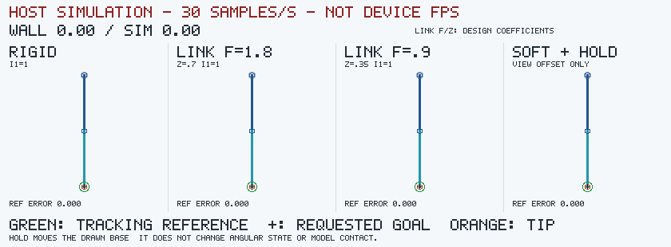
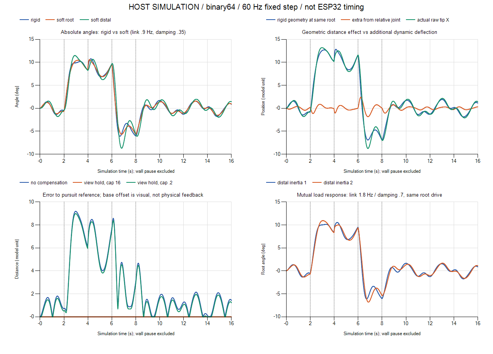
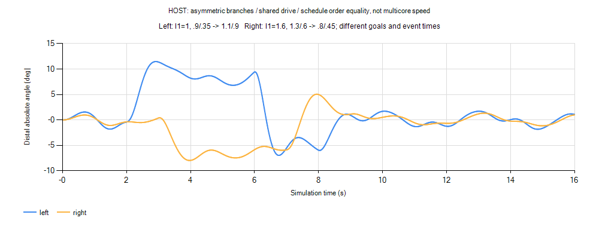

# 動的演技の最小机上計算・host比較

2026-10-30。基準製品headは`c73d26c`。今回の成果は**ローカルのPython参照計算・図版・仕様草案**で、ayatsuri製品実装ではない。[仕様草案](../api/ayatsuri-dynamic-motion-draft.md)の全機能を作らず、小LUT共通励振＋静的目標＋二つの状態付き自由度だけを比較した。公開/flash/merge/実機操作なし。

## 先に得られた結論

- 同じ根元入力でも、連結の柔らかさ/減衰を変えると先端の遅れと揺り返しが変わる。今回の柔連結では半到達が根元より**約100ms遅い**。硬い連結は同時。
- 64点int16 LUTの入力近似は、同位相sin参照に対し本条件の先端誤差**最大0.00184 model unit**。小LUT＋少数波の合成は検討を進められるが、サイズ確定/速度優位/自然さの受入ではない。
- 再現・pause・描画cadence・非対称の順序不変は合格。**収束時間の厳しいprobeは一部未達**。結果JSONにもFAILを保持し、全項目PASSとはしない。
- 保持は表示上の基部XY補償。物理的な補償力/駆動遅れ/IKの成功とはしない。主系の角度/速度は補償ON/OFFで同一。

## 比較動画とグラフ — HOST SIMULATION



APNG、331枚/先頭11秒wall time。更新は60Hz、表示sampleは30Hz。5.5〜6.5秒wall timeでsimulationと位相を停止し、休止時間を投入せず再開。注記のwall時計は動くが、物体のstateは同じ。末端の緑輪は追従reference、黒十字は要求goal、橙が実際の末端。最後までの16秒simulationはCSV/グラフで確認する。



## 仮定・単位・更新式

同じ根元励振を受ける**二つの等価回転子**をspring/dampingで結ぶ小モデル。棒の表示は平面上、長さL0=L1=35 model unit。角度q0/q1は絶対角rad、速度rad/s。階層TRSへ移すなら子のlocal角はq1−q0。長さは出力幾何に使い、棒の形から質量行列を導出した二重振り子ではない。重力/筋肉/神経/接触は未モデル化。

I0=1、I1=1（追加比較は2）の相対慣性。gは次の入力まで保持し、retargetでq/vをresetしない。q/v/追従reference状態はhostではbinary64。以下は定係数区間の運動式:

```
M = diag(I0,I1)
K = [[ka+kc, -kc],[-kc,kc]]
C = [[ca+cc, -cc],[-cc,cc]]
M*q'' + C*q' + K*(q-g) = [2*u,0]
```

根元だけへ共通信号uを入力。反力が親へ戻る相互連成であり、一方向cascadeとは区別する。ka=(2π·1.2)^2、ca=2·.7·2π·1.2。kc/ccは設計周波数fcと減衰係数ζcからkc=(2πfc)^2、cc=2ζc·2πfc。参照連結fc=1.8/ζc=.7、柔連結fc=.9/ζc=.35。係数は正規化したs^-2/s^-1、励振は基準慣性で正規化したrad/s²相当。実物のkg/Nを称さない。

設計値1.2/1.8Hzは連成後の振動数ではない。参照連結I1=1の非減衰固有周波数は約.8006/2.698Hz、I1=2は.6285/2.430Hz。減衰も一律modal ζ=.7にはならず、参照の速い枝は過減衰。相対慣性変更で根元の角度にも最大約.03378radの差が出た。一方向cascadeの子慣性変更では根元は変わらず、相互連成の代用にはならない。

積分は**完全な後退Euler**、h=1/60秒。行列逆数は係数設定時だけ計算する。

```
(M+h*C+h²*K)*v_next = M*v + h*(f-K*(q-g))
q_next = q+h*v_next
```

固定goal/励振OFFでE=.5vᵀMv+.5(q−g)ᵀK(q−g)とすると、

```
ΔE = -h*v_nextᵀC*v_next -.5*ΔvᵀM*Δv -.5*h²*v_nextᵀK*v_next <= 0
```

M正/K正定値/C半正定値なら左辺の行列はh>0で正定値。semi-implicit Eulerの刻み上限を流用しない。ただし大きいhほど数値減衰/軌道誤差が増え、任意のhで見た目が同じという意味ではない。target/impulse/係数切替では外部からenergyが入り得るので、この無入力減衰検査へ混ぜない。

## 入力・時刻・保持

単一の共有LUTを3 oscillatorで線形補間合成。周波数.31/.73/1.13Hz、重み.55/.30/.15、絶対重み和1。int16値を32767で正規化し、各位相/増分はuint32 wrap。seed42は初期位相だけを決める。更新中にsin/乱数を呼ぶのは**信号生成には不要**だが、幾何のsin/cosは別費用。有限精度なので最終的には周期性がある。これは姿勢軌跡のLUTではなく、共通の駆動入力。

simulation時刻2秒でgoal角を.15rad/要求world点を(4,69)へ変更、4秒で根元へ角運動量impulse .8、6秒で−.08rad/(−4,69)、8秒で0/(0,70)へ変更。rigidはI0+I1の合成慣性を使い、同じimpulseを.8/(I0+I1)の速度変化として与える。単に同じΔvを入れて異なる衝撃量にしない。

要求world goalと、そこへ状態付きspringで進むreference rを分離。referenceは1.5Hz/ζ=.8の陰解法で位置/速度を保持する。表示補償は`baseOffset = reference - rawTip`、長さ上限16 model unitの半径方向clamp。角度/速度へは書き戻さない。goal自体を瞬間移動させた直後、reference誤差が0でも要求goal誤差は最大約7.845unit残り、retargetに瞬間追従したわけではない。

上限16では今回clampなし、reference残差は丸め誤差程度。上限.2の負例では885stepがclampされ、最大約8.988unitの残差。これは表示補償の範囲不足で、関節限界/IK到達不能の検証ではない。

## 遅れ・距離増幅・動的応答を分けた数値

半到達とovershootは励振OFFの2秒goal変更から4秒impulse前まで。60Hzのsampleによる観測で、substep精度の時間保証ではない。

| 条件 | 根元t50 | 先端角t50 | 先端角overshoot |
| --- | ---: | ---: | ---: |
| rigid、I1=1 | .2333 s | .2333 s | .02141 rad |
| 参照1.8/.7、I1=1 | .2333 s | .2500 s | .02911 rad |
| 柔連結.9/.35、I1=1 | .2167 s | .3167 s | .05015 rad |
| 参照1.8/.7、I1=2 | .2667 s | .3167 s | .04479 rad |

幾何の末端Xは35sin(q0)+35sin(q1)。同じ根元角で全長を剛体にしたXgeom=70sin(q0)、動的差分Xdyn=35(sin(q1)−sin(q0))を別に記録。柔連結の12〜16秒RMSはXgeom約1.1204、Xdyn約.2147、実末端X約1.2442unit。瞬時には和になるがRMSを単純加算しない。距離による拡大と、相対角の遅れ/共振による変化を混同しない。

| LUT点数 | 波形のみ | 同位相sin比の入力最大誤差（36,000 sample） | 本scenarioの末端最大誤差 |
| --- | ---: | ---: | ---: |
| 32 | 64 B | .00445512 | .00732464 unit |
| 64 | 128 B | .00113962 | .00183959 unit |
| 256 | 512 B | .00007023 | .00011621 unit |

同じ量子化位相/同じ入力履歴で、sin参照と比較した誤差。候補64が常に必要/十分とはしない。sin/軽量PRNG/補間の時間比較は未実施で、LUTが必ず速いとは結論しない。

## 合格と未達

| 試験 | 結果 |
| --- | --- |
| 信号の有界性/seed再現/初期位相/境界 | 5 unittest成功。step中のsin/新規乱数なし。reset/pauseと12,000step再現 |
| 無入力energy | 30/60/120Hz×慣性2条件×連結2条件、16,800stepで増加なし |
| 全励振OFF | 通常の参照連結は収束。柔連結/重慣性の時間内閾値は下記未達を含む |
| 励振ON | 今回の全比較条件でfinite、角度絶対値<.5rad、速度<4rad/s。入力上限を一般の変位上限とはしない |
| 描画15/30/60/120Hz | 同じsimulation stepの全state/共通位相が一致。pause中はstate/位相が不変 |
| retarget/impulse | goal変更だけではq/v不変、impulseは一度、再開で停止時間を投入しない |
| 表示補償 | ON/OFFの内部角度/速度/referenceは一致。物理的な保持力の合格ではない |

初期の厳格probe「20秒後の角度<1e−8rad」は柔連結/I1=2で未達。60Hzで1.05975e−8rad、120Hzで2.22835e−8rad。energyは約1.17e−15/5.52e−15で減少し続け、発散ではない。さらに全scenarioを16秒走らせ「角度/速度<1e−4」としたprobeでも、この重い柔連結の速度は約1.96614e−4rad/sで未達（角度約2.92939e−5rad）。**閾値を緩めて合格へ変更せず、JSONにFAILを保持した**。係数/許容誤差/到達時間をどう選ぶかが次の判断。

120Hz軌道との差は、30Hzで末端RMS .25229unit/先端角最大差.01976rad、60Hzで.08821unit/.00683rad。これは120Hzを真値とした誤差保証ではなく刻み比較。60Hzは次の候補だが、120Hzと同等とも最終採用とも言わない。

## 左右非対称・行き戻り・並列化の境界



共通driveを各step一度生成し、別々に所有する左右branchへ読取入力する。左I1=1/入力倍率1、右I1=1.6/倍率.65。左は2/6/8秒で.15/−.08/0、右は3/7/9秒で−.11/.04/0へ変更。帰りに左は連結.9/.35→1.1/.9、右は1.3/.6→.8/.45へ前計算を更新する。q/vは保持。これは共通の外部駆動を受ける独立rootで、共通torsoを介した左右の反力までは含まない。

枝の順序を正順/逆順/交互にしてstate hash/共通位相一致。別の非対称初期値/goal/慣性でDOF gatherを昇順/逆順/seed付きshuffleし、720stepの全state一致。各行は同じimmutable old値を読み、和の順番を固定した。意図的に途中更新値を読むin-place負例は最大約.150545のstate差を検出した。

最小の2×2 blockは旧q/vから両RHSを作ってからnextを計算し、exclusive ownerが一括で公開する。全actorを丸ごとcopyする必要はなく、旧scalarと候補を局所workへ保持できる。独立キャラ/枝は並列候補。FKは親depthごと、共通親の力還元/拘束/補償は依存段階を分ける。Jacobi反復なら回数/workが増え、Gauss–Seidelは順序依存なので、同値性を黙って仮定しない。

## 1passの演算/bytes — 実測時間とは別

左右対称性や往復逆再生による省略を前提にしない。現sourceの相互2DOF blockを数えたもの:

| 対象 | 乗算 | 加減算 | 備考 |
| --- | ---: | ---: | --- |
| 誤差/RHS | 7 | 8 | 非対称の慣性/goal/係数を各枝から読む |
| 連成solve | 6 | 2 | 逆行列は設定変更時に前計算 |
| 位置更新 | 2 | 2 | 合計15M/12A、1DOF平均7.5M/6A |
| reference XY | 6 | 6 | 1枝ごと。物理2DOFとは別 |

LUT3波は6つのint16 lookup、補間/位相u32加算/重み合成。根元入力倍率、検証、radial clamp、幾何/記録は上表の外。現Python `record()`は7 trig＋2〜3 hypot、dict等を確保する。可視化/CSV収集を含むPython runtimeがno allocation/copyで軽いと主張しない。

仮のpacked C配置でq/vは1枝16 B。state4値＋入力2値＋係数8値を一度ずつロードする仮定ならF32で56 B read/16 B write、係数をF64にすれば88 B read。実際のcompiler load/store/cache trafficではない。係数変更時に行列/逆数を再計算し、毎stepの逆行列計算はしない。

raw構造例の内訳: LUT128 B、3 oscillatorのphase/inc/weight36 B＋reset seed4 B、物理q/v16 B、reference位置/速度16 B、active goal12 B、inverse32 B、物理係数24 B、h8 B、reference係数16 B、step4 B、幾何/入力設定16 Bで**312 B**。候補state32 Bと幾何scratch例56 Bを足すと400 B。ただし128 Bは共有readonly候補であり、padding/allocator/JS object/view/コード/rig/描画buffer/stack peakは含まない。実C/JS実装のRAM測定ではない。host図版は840×310×RGBの大きなbufferを使い、これをdeviceへ持つ提案ではない。

一般N DOFでq/v F32のold/next全量を持つなら合計16N B（単一stateから追加8N B）。scalar edge力を一度計算してgatherするなら4E Bのwork、各DOFで両側を再計算するならedge計算が増える。scatter-addは競合対策が要る。SoA/batchは将来候補だが、余計なJS viewや全scene二重bufferを無条件に増やさない。今回の並べ替え試験はsingle-threadで、thread/ESP32多コアの速度優位は未測定。

## 再現と残る限界

[実行手順](../../tools/character/dynamics_study/README.md)、[数値原本JSON](dynamic-motion-host-results.json)。CSV/animation JSONは`.cache/dynamics-study-final/`、ログは`.cache/dynamics-study-final.log`、`.cache/dynamics-signals-final.log`。初期probeのassert失敗ログも`.cache/dynamics-study-{strict-convergence,expanded-convergence}-failure.log`へ保存。最終JSONはsource SHA256を持ち、exit code0を全probe合格の意味にしない。

次に判断できるのは、小LUT共通入力＋状態付き連結という最小近似を続ける価値と、係数/到達時間/補償の許容範囲。実キャラ3D rigへの接続、一般morph、IK、physical補償、重力/荷物の負荷、無確保のC/JS核、HOME adapter、実機速度/画質は未実施。今回の机上/hostの数字をそれらの成功へ転用しない。
