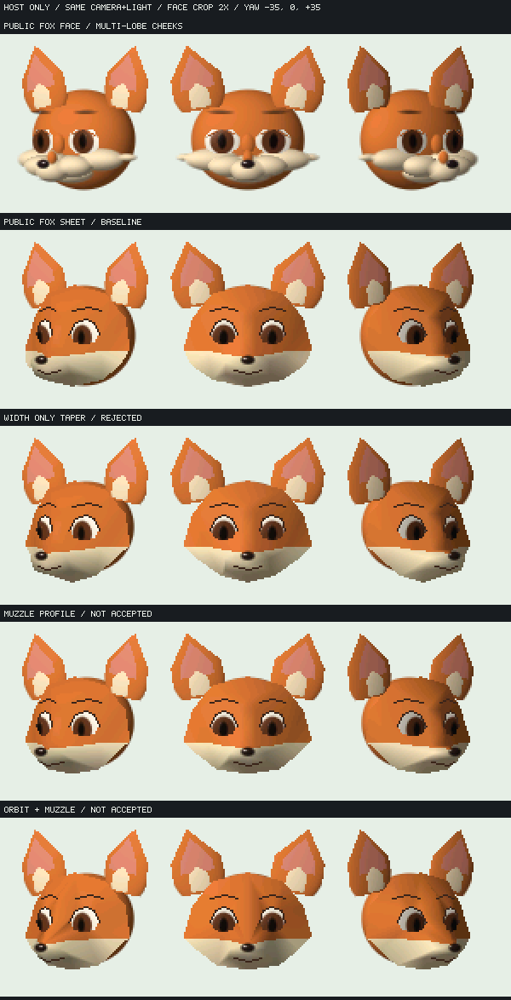

# 狐の頬・口吻の造形診断

実機での「頬がモコモコして造形が不適切」という指摘を、動作smokeのPASSとは別に扱う。023559fにはFOX FACEとFOX SHEETが共存しており、どちらを見たかは未特定。片方だけの問題と決めつけない。

全列はneutral、yaw −35/0/+35°、pitch0、world light方向[-.5,-.4,.8]、240×135の同じcamera/zoom。顔領域(75,10)から100×105を切り出して最近傍2倍表示した**ホストシミュレーション**であり、実機captureではない。上2行は公開023559fのモデル定義、下3行は未採用のローカル試作。実機の表示内容や造形合格と混同しない。

| 条件 | 所見・判断 |
| --- | --- |
| FOX FACE | 白い頬の8ローブと下顎の3ローブが、髭の球・中央口吻・顎板として分離して見える。設定図の連続した頬毛／口吻から外れる。 |
| FOX SHEET基準 | 独立した髭球は減るが、下顔が大きな半円に見える。斜めは白い横帯と顎の弧が強い。 |
| 幅だけを縮めたtaper | 頬下部52→44、顎寄り32→24。mask・材質・眼は固定。饅頭感は減るが、尖った顎と楔形になるため不採用。 |
| 口吻profile | 顎を短くし、中央口吻を狭く前へ出す。単色表示でも差があり、色だけの錯覚ではない。ただし正面は台形、斜めは箱・楔に見えるため未採用。 |
| 眼窩と口吻の接続面 | 一つの38頂点・50面を既存32頂点上限の2バッチへ分割。眼と顔面の接続は前進したが、中央の鼻梁が硬い稜線になるため未採用。 |

独立画像レビューも、幅だけの変更を採用せず、同じ連続面で中央マズルと眼窩の曲率を確保する判断だった。設定図では頬毛は輪郭側へ控えめに開き、中央のマズルは小さく丸く前へ出る。独立球を増やして毛量を表す案へ戻さない。色境界の変更だけで解決したとも扱わない。

## 実装・資源との切り分け

試作は固定形状・法線・materialをnative readonly資産へコンパイルし、既存Model/Instanceで描画する。既定FOX FACE／FOX SHEET、製品のprovider、実機023559fは変更していない。固定資産の共有、個体別poseと明示的解放、packet snapshotの既存契約を維持し、Cの頂点上限やQuickJS capは増やしていない。

各試作のm32実QuickJS試験は78frame×2process、incremental/full-reference一致、停止、3回release/recreate、終了guest/live0を通過。FOX FACEの新しい比較captureは実app243frame×2processから取得した。これは造形の合格を示さない。

2バッチ条件は対照profileのguest会計peak131648 Bに対し132992 B（+1344 B）、最大単一request6883 B、上限163840 B、強制frame GCなし。モデル全体38頂点を10頂点8面／32頂点42面へ事前分割し、共有する位置・F32法線・maskを一致させた。355のyaw/pitch標本で固定面順とnearest-Zの差は0、逆順の負例は12340 pixel-samplesの差を検出。連続した全角度、別packetとの一般遮蔽、ESPのpeak／stack／速度や画質の保証ではない。

未採用試作の生成コードと詳細ログはローカルに保持している。画像取得のための待ち時間やsleepではなく固定入力で比較した。次の比較は上部鼻梁の形状と曲率であり、表情遷移・全身・他キャラ・2.5D画像版の完成には数えない。

[公開基準の資産・実機phase記録](fox-native-asset-study.md) · [native mesh契約](../api/ayatsuri-native-mesh.md)
