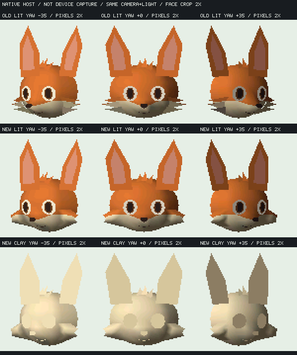
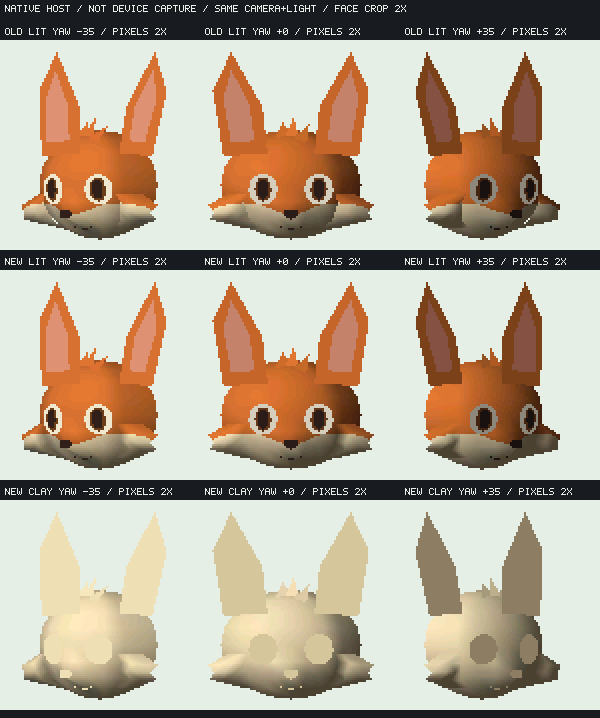

# 狐の中央量感と曲面頬毛の比較

6546f1dの[頭蓋・マズル・毛束の分離](fox-surface-separation.md)を保ち、中央マズルを控えめにし、6つの細い頬三角形を左右2枚の幅・曲率のある面へ置き換えた。既定製品・実機023559fは変更していない。


旧／新はcamera・投影・無陰影条件を一致させ、240×135の顔領域x75/y10/幅100/高105を最近傍2倍表示した。参照は元の照明を持つ設定画で、yawも未校正。顔幅の手動近似で表示尺度を揃えているが、参照まで同じcamera／光と主張しない。存在しない逆向きviewは鏡像で補っていない。

## 1案の変更と局所的な修正

頭蓋・前髪・耳と眼マーカーのXYは保持。中央の解析マズル場は中心[0,7.5]、支持半径[9,5.5]、最大変位9とした（旧は[0,8]／[11,8]／14）。外頬へ前突量を広げずに、中央だけを調整する自由度を使う。支持域のC1は解析場の性質であり、nativeの三角形補間・全pixelへそのまま保証しない。

頬は左右各20頂点24面のsheetで、根元から輪郭まで4点、縦に5断面を持つ。幅のある輪郭、奥行きの弓なり、頭部への重なりを作り、細い棒を並べる方法をやめた。無陰影の独立レビュー後に、固定した形状でnative lit／clayを確認した。



最初のsheet案は解析surfaceから根元の深度を取り、法線をsheet内だけで平均したため、厚い羽根・クッションと硬い接続に見えた。幅・曲率をさらに増やさず、実head meshのF32三角形から根元の深度・法線・maskを重み付きで取得する修正を比較した。



上段は初期対照、中央はmesh根元、下段は修正版clay。根元は左右5点ずつ、head三角形内で一意に決まり、深度＋0.05、補間・再正規化した法線、補間maskを使用する。対照の生成SHA518d569a…は初期案とbyte一致し、修正版SHA7879b215…と区別した。

これは**offlineの静的サンプリング**である。根元間の辺全域の追従、C1、Gouraud陰影色の完全一致、動的な接続機能の実装済みを意味しない。頭部と頬のposeは今回同じroot変換だけを受ける。

## 再現経路と測定

[生成器](../../tools/character/fox_cheek_surfaces.py)／[参照と旧新の比較](../../tools/character/fox_cheek_compare.py)を使用する。globalパラメータの書換えはせず、既定生成経路のModel／画像が変わらないことも検証した。

```text
python tools/character/fox_cheek_surfaces.py
python tools/character/fox_cheek_surfaces.py --root-attachment analytic --out-dir .cache/fox-cheek-analytic-control
python tools/kasane_contract/run_fox_patch_host.py --m32 --redesign --variant compiled-combined --compiled-assets-dir .cache/fox-cheek-joined/lit --result-dir .cache/fox-cheek-joined-m32-lit
python tools/kasane_contract/run_fox_patch_host.py --m32 --redesign --variant compiled-combined --compiled-assets-dir .cache/fox-cheek-joined/clay --result-dir .cache/fox-cheek-joined-m32-clay
python tools/character/fox_cheek_compare.py --face-crop --out .cache/fox-cheek-compare.png
```

比較に原画を含める場合だけ `--reference <consumer-local PNG>` を追加する。Library `libfile_6be7d8a574e88191a1b4c8bb83517684` の元PNGで、期待SHA・chunk CRC・RGB8bit非interlace・展開長を確認する。未指定時は参照欄を空けて旧／新を再現でき、自動downloadはしない。

| 同じ専用fixture | 6546f1d | 今回 |
| --- | ---: | ---: |
| cold資産 B | 11464 | 11912 |
| node／mesh数 | 26／25 | 22／21 |
| cold頂点／面数（batch重複含む） | 242／231 | 264／273 |
| native instance arena B（guest会計内） | 31756 | 27436 |
| m32 guest会計peak B | 96120 | 91604 |
| rounded request peak B | 89564 | 85048 |
| 最大単一guest request B | 31763 | 27443 |

部品数減と頂点・面数増を同時に行った比較であり、節約をどれか1つの効果へ分離していない。flashの＋448 BをRAM節約へ混ぜない。whole app／実機heap・largest・stack・速度は未測定。

解析根元対照とmesh根元修正のlit／clayはm32各78frame×2process、64bit ASan／UBSan litも各78frame×2processを通過。160KiB／resource1024、強制frame GCなし、全frame incremental/full-reference一致、光変更の画像差、無効入力の旧commit保持、停止8回の画素一致、3回release/recreateのplateau、終了guest/live0、2process画像／hash一致を維持。修正版64bit guest peak117732 Bはm32と混同しない。root点サンプリングやraw Model／PNGも2回再生成のbyte一致を確認した。

## 判定

独立画像レビューは、棒状の毛先の軽減と、mesh根元修正による−35°の硬い境界・中央から頬への陰影の改善を確認した。ただし完全な接続には至らず、毛先上縁の硬い折線、羽根・クッション状の頬、鼻下〜顎の大きな量感が残る。**接続方法の改善は保持するが、現モデルの製品採用は不可**とした。数値試験のPASSを造形合格に置換しない。
