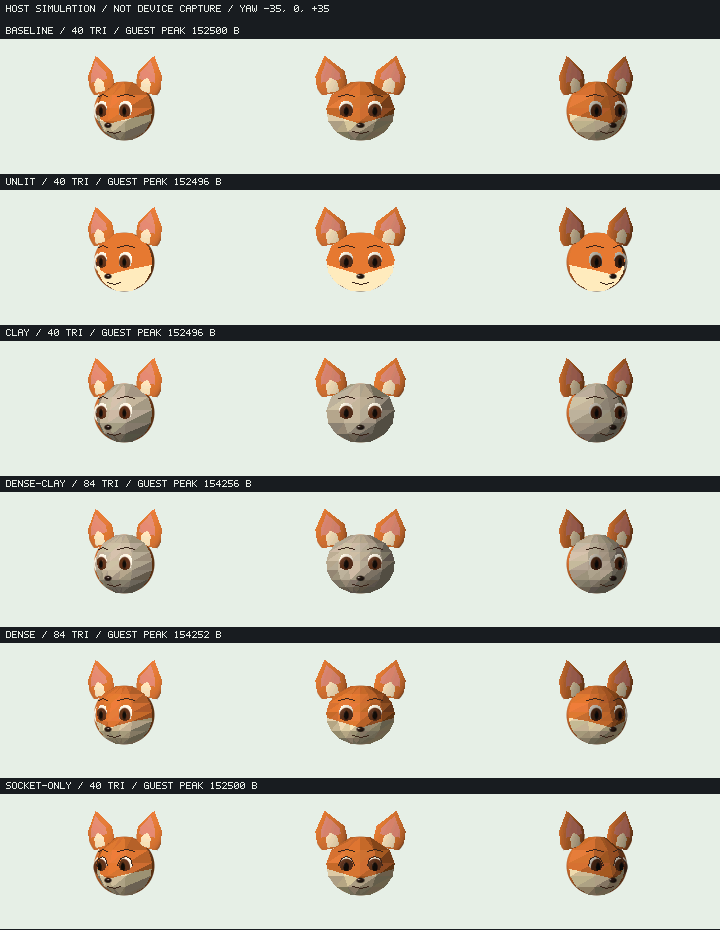
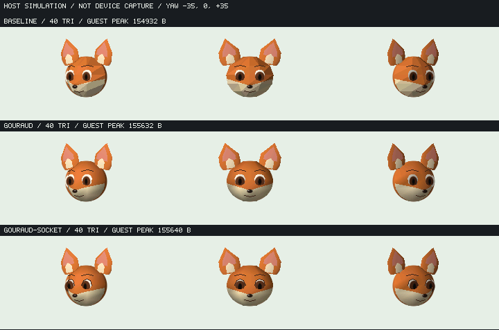

# 狐の共有faceとGouraud補間の小実証

[性能文書](README.md) / [hone shapes API](../api/shapes.md) / [既存狐顔v4](fox-face-v4.md)

診断候補`a4185e2b4f4b7072a40c8988fd3f9ded159502cf`は別の実機A/C計測対象として固定する。この後続作業はhostの描画機能・狐顔面patchの小実証で、既定の狐asset/製品appを置き換えない。全身・全表情・pitch・物理LCDの受入ではない。後続製品sourceはTRACE/phase-onlyの既定をOFF/OFFへ戻す。

## 原因を分ける比較

設定画（Library `libfile_6be7d8a574e88191a1b4c8bb83517684`、取得済みPNGを実見）の目標は、眼が収まる眼窩、頬から前へ張り出す口吻、そこに付く小さい鼻である。既存v4の別volumeの白頬を、30頂点/40三角形の一面へまとめた初案は白ヒゲの団子感を弱めたが、面ごとのshade→単色fillにより硬い三角帯になった。

この一覧は**Gouraud追加前のローカル比較**であり、複数段階のソースを経た調査記録。各画像は240×135の実QuickJS/native host出力。各条件で同じorthographic camera/world lightを使う。

| 条件 | 変えるもの | 観察と採否 |
| --- | --- | --- |
| baseline、40tri | 初期案 | 顎を横切る暗い三角帯と白い眼リング |
| unlit、40tri | 面照明だけOFF | 三角帯はほぼ消える。毛色の直線境界と平坦な口吻は残る |
| clay、40tri | 固有色を同じ色へ | 三角帯は残る。毛色だけの問題ではない |
| dense-clay / dense、84tri | 同じ解析面の標本数 | 断片が細かくなるだけで硬さの解決は弱く、面数追加を採用しない |
| socket-only、40tri | 開口上部/虹彩比率/上瞼線 | 白リングは軽減するが、眼窩への接続と顔の識別性は未達 |

144tri案はfillでframe drawing limit、84tri＋socketは2枚目のoutlineで同limitに達した。heap quota/allocator failureは0だったが完走ではない。上限を増やして通さず、失敗記録を残した。その他6条件は各78frame×2 process（計936frame）、全frame reference・停止決定性・解放/再生成・終了guest/live 0を確認。m32のguest peakは152496〜154256 Bだった。これらを後続実装と**同headの性能差**として引き算しない。

## 最小機能

面数追加ではなく、同じ30頂点/40三角形に`hone.gouraudPatch`を使う。既存`shade`が共有頂点ごとに求めたorange/cream両方のRGB565を補間し、別のbody-local scalar maskでどちらを使うか選ぶ。cameraだけを回したときは投影とworld normal、lightだけを回したときは色fieldを再評価し、毛色のmaskは変えない。

- screen-linear補間。現在のfixtureはorthographic、perspective-correct/UV/alpha/一般depth sortは対象外。
- max32頂点/64三角形/2凸穴（各3..8）。画素中心は整数、共有辺はtop-left所有、穴境界は除外。
- 全入力を検証後にcandidateが数値snapshotを所有。JS bufferを描画後まで借りず、失敗時はcandidate/building/committedへ未適用。
- serialized payloadは8＋16n＋6t＋68h B、10 Bへzero padding。30/40/2で864 B、geometry込み88 entries。全画面buffer/Z bufferを追加しない。
- coverage/weight/maskはwide参照演算を保ち、bounded RGB565 channelの補間だけF32。色誤差とcoverage/選択を分けて検証する。

Gouraudを使うと同じ面数で暗い三角帯が減ることを作者・独立画像レビューが確認した。下顎/光と反対側の暗さは残っており、白飛ばしではない。**描画機能を採用候補へ進める根拠**であり、モデルの製品置換には至っていない。白橙の直線帯、丸い盾状の輪郭、眼窩の浅さ、短い口吻、小さい鼻口が残る。

| 最終m32同source（各78frame×2 process） | 元fill | Gouraud | Gouraud＋眼 |
| --- | ---: | ---: | ---: |
| guest会計peak B | 154932 | 155632 | 155640 |
| requested peak B | 138332 | 138872 | 138880 |
| 最大単一成功要求 B | 9199 | 9199 | 9199 |
| 累積turn alloc calls（78frame、1process） | 6446 | 6442 | 6754 |
| 累積turn alloc bytes B（同上） | 481772 | 481588 | 492820 |

全frame reference、反復画像、停止、不正view、release/recreate plateau、終了guest/live 0がPASS。native endpointを直接反復する1000warm呼出しのalloc 0と、このscene評価を含むJS turnの確保は別である。今回の機能追加はメモリ削減ではなく、同じ低い面数で照明を連続させるための費用である。

## 検証と費用の読み方

初期wide色版の実QuickJS/native m32は78frame×2 process、全reference、停止/不正view、解放再生成plateau、終了guest/live 0でPASS、guest peak155640 B。後続F32色版は上表の最終同source比較と区別する。host時間をESP32速度/FPSへ読み替えない。

`python3 tools/kasane_contract/run_pocket_proc_qjs.py --gouraud-only --opt 2 [--m32]`は実boundaryを検証する。snapshot後のbuffer改変、各band高さ、mask/色/穴のdamage、IO repair、late invalid、shared/detached/foreign非整列入力、予算拒否後のcommitと復帰、共有辺の提出順反転、1000warm updateでalloc 0を検査する。packet側は全truncation、末尾padding、reserved/未使用領域、範囲/index、offscreen/cost、512変異を検査する。

`python3 tools/kasane_contract/run_fox_patch_host.py --variant gouraud-socket [--m32]`は78frame×2 processでyaw sweep、固定poseのlight変更、同入力停止、view拒否、release/recreateを行う。`baseline` / `gouraud` / `gouraud-socket`を同sourceで比較する。releaseはModel/Instanceを解放し、fixture自身の固定geometry buffersとresourceは再生成用に保持する。runtime終了時のguest/live 0と、scene-only解放を混同しない。返却値は再利用statsで、immutable snapshotとは呼ばない。render中の全JS費用にeval/parser/capture/stats/native presentationが全て含まれるわけではなく、result.jsonのtiming_scopeを優先する。

証拠は`.cache/gouraud-contracts/`と`.cache/fox-patch-host/{m32,asan64}/{variant}/`。source/artifact hash、成功/失敗、反復画像、guestとrequested peak/最大単一要求を分ける。native arenaはguest会計に含まれ、別の無料RAMへ逃がしたわけではない。JS arena断片化やESP free/largest、実機GC/stack peakはこのhost試験から主張しない。

Astraの独立mixed/wide比較は8576 fixture（8552 valid/24 reject）、32889798描画sampleでcoverage差0、A/B選択差0、RGB channel最大差[1,1,1]。整数/小数/nextafter/±4096/極細/area閾値を含め、共有辺2000件は二重所有0、band比較640回は一致した。これは検査した条件での結果で、任意のill-conditioned入力への無制限の精度保証ではない。単発MinGW描画時間はwide1.785秒/mixed1.936秒（背景初期化と検証込み）であり、hostでもmixedが速いという結果ではなかった。S3速度改善を主張しない。

ASanの初回boundary試験は、foreign非整列入力をnativeが読み終えた後にfixtureのinitが同bufferへJS typed-array書込したことで、QuickJSのfloat store alignmentを検出した。native読取りの後に普通のaligned viewへ戻す試験修正を行い、misaligned readonly入力の検査は維持する。upstream VM変更やsanitizer無効化では通さない。

新packetの作業構造1040 Bは専用noinline helperへ置き、旧render経路のlocal frameを増やさない。AstraのXtensa単体コンパイルでは旧`render_band_ext`896 B、`ksn_proc_render_band`80 Bは変更前後同値。新経路は1104 B decode＋336 B band、穴helper等を含め2608 B＋上位caller/libgccという計算例。実機stack highwaterではなく、RGB F32化前の測定である。F32化後のband単体は320 Bで、旧経路は同値だった。BSS追加0の単体object観測と、製品全体RAM/flash差は別に計測する。

ayatsuri JS/Cの共通mesh authoring/native asset section、view-dependent形状corrective、表情/attachment/clipの同frame確定は後続。今回は低層の照明段差を解く小さい経路であり、これだけで狐完成や3体完成、2.5D画像版へ進んだとはしない。

最終ローカル検証はm32/ASanの新boundary、旧clip ASan、上表のm32 3条件、新patch ASan、旧狐m32、旧proc45a06e0との通常/fake-PIE raster比較がPASS。ASanのfixture誤用修正後も1000warm呼出しalloc 0/終了live 0を維持した。通常OFF/OFFの製品preflight linkとprofile self-test（6正/8負）も成功。公開headのCI完了は別に照合し、実機確認は未実施である。
