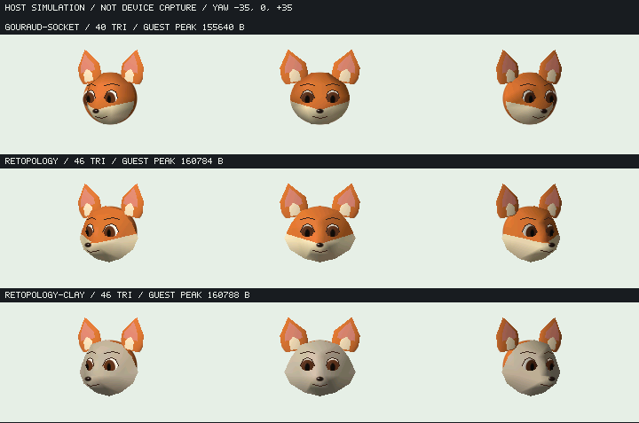

# 狐30頂点46面と明示的な可視面選択（host比較）

結論：可視面utilityは成立したが、この造形案は既定狐への置換に**不採用**。鼻口吻の奥行きと頬幅は前進した一方、白いV字帯、角張った顎、黒い穴のような眼、短い口が残る。160 KiB会計にも余裕が小さい。既定fox asset/appは変更していない。診断実機候補a4185e2bとも別のhost試験で、flash/物理LCD評価は行っていない。



全て240×135のnative renderer出力を並べた**ホストシミュレーション**。yaw −35/0/+35°、同じorthographic zoom1.3/center120,78、固定world light (−.5,−.4,.8)、neutral。3列のカメラ/光条件は各行共通。新形状の単色行はalbedoだけを揃え、形/法線/照明と毛色境界を分離した。表示拡大は最近傍で確認できる。設定図との完全一致・キャラクター完成・実機画質受入を示すものではない。

## 再現した問題と最小の修正境界

従来の30頂点40面の前面gridから、輪郭12点、眼窩縁8点、鼻筋/口吻/顎などを明示した30頂点46面へ置き換えた。XYZとtriangulationは`tools/character/fox_retopology_fixture.js`の固定データで、法線は同じXYZのarea-weighted face normalを頂点へ集約する。眼開口・眉・口・鼻のattachment Zは同じ面のbarycentric座標から求める。光に応じて法線を変えるのではなく、姿勢で法線をworldへ変換して既存shadeを使う。毛色maskはbody-localのまま保持する。

新案をそのままhoneへ渡すとyaw −35°で3面（ID26,28,37）、+35°で3面（30,32,40）が裏向きとなり、全packetが拒否される。indexを反転して隠す方法は採らず、[optional ayatsuri visibility](../api/ayatsuri-visibility.md)で投影後の表面を選び、元の頂点番号とwindingを維持する。可視数は43/46/43。旧7引数honeは維持し、第8引数triangleCountで固定容量index bufferの有効prefixだけをsnapshotする。

選択と描画を分離し、明示的`authored`順と`centroid-depth`順を用意した。後者は一般Z解決ではない。今回の同patchには独立の画素ごとnearest-Z参照を用い、yaw −35/0/+35 × pitch −10/0/+10の9条件で非tie差分0画素、可視41..46面、重なりのある条件47..60画素でも一致した。順序を逆にする負対照は−35°/pitch0で60画素の差を検出した。pitchはoracle上の拡張試験で、現在のnative fixture操作はyawだけ。連続角度域全体、眼/鼻の別packet遮蔽、一般meshの循環遮蔽まで保証しない。 当初oracleは半画素中心で実装されていたため、独立指摘後に実Gouraudと同じ整数(x,y)中心・ceil(min)..floor(max)の両端inclusive bbox・canonical edgeへ修正した。修正後の件数を上記へ反映し、fractional座標の矩形で整数中心と右/下端を検出する回帰、描画順逆転の負対照もテストへ固定した。製品rendererや造形データの変更ではない。

## ホスト資源比較

同じ最終製品Cソース条件、32bit/SSE2 QuickJS、上限163840 B、通常GC、強制frame GCなし。各variantは独立process×2、各78frame。旧対照も今回再実行し、以前のSHAの画像/peakを流用していない。

| neutral fixture | requested peak B | guest会計peak B | 最大単一request B | typed backing B | 78frame中alloc呼出 |
| --- | ---: | ---: | ---: | ---: | ---: |
| 従来Gouraud/socket 30v40t | 138880 | 155640 | 9199 | 2694 | 6754 |
| 新30v46t | 143184 | 160784 | 12612 | 3414 | 7009 |
| 新形状の単色対照 | 143188 | 160788 | 12612 | 3414 | 7009 |

新案は旧案よりguest会計peak +5144 B、requested peak +4304 B、typed backing +720 B。残り3056 Bはhost QuickJS会計上限までの差で、ESP largest freeや次回大口確保の保証ではない。constructor/コード解析/一時配列/JS object headerの各寄与は未分離なので、差分全量をselectorのsteady buffer費用と呼ばない。selector backing自体はsource/output各276 B＋counts12 B、生成検証用のxy/depthは一時。native arenaは既存29node資産と同じ経路で、会計外への退避ではない。

C kernelのO2 host参考値はtext1492 B/data0/BSS0、stack800 B。これはgcc host objectの値でありXtensa値ではない。通常選択200回はallocator呼出0。実QuickJSでも選択＋optional utility＋Gouraudを含む1000回のwarm scopeでalloc0。ただし表のapp全体はnative scene評価等を含みallocがあり、app全体noallocとは言わない。ESP時間/stack/heap分布/FPSは未測定。

## 検証と残差

- 実QuickJS O2 ASan/UBSan と32bit境界試験：型/有限/範囲、短出力、全capacity alias、readonly出力、detached/foreign misalignment、全5種類のC生成Shared backing拒否、失敗時byte不変、生成失敗、2selector独立、borrowed result/dispose。Gouraud prefix/旧7引数/unused tail、damage/IO repairも対象。
- 新案のASan/UBSan64bitとm32、旧対照/単色m32：各78frame×2、61点yaw sweep、光のみ変更、停止8frame、invalid view拒否、release/recreate3回、差分描画と全再描画一致、画像/hash反復一致、終了guest/live0。
- 独立C/JS Number参照20000回、選択581166面、閾値近傍2500例：分類/順序/prefix/tail一致。ordinary gate欠落を独立レビューで発見し、selectVisible専用の検証で修正。既存shade helperの挙動はこの変更に含めて変えていない。
- 独立画像レビューでも、旧丸盾形状から口吻の立体は前進、大きな接合穴や眼の白漏れは目立たない。一方、目標の丸くふくらむ口吻と頬・自然な眼窩へ届かず、費用増に見合う既定置換とは判断しない。

次の造形判断は係数の微調整だけを重ねず、口吻上面/頬下側/顎の曲率と、眼球を包む瞼・開口の構成を分けて検討する。今回の面選択機能が一般の自己遮蔽や表情モーフを完成させたとは扱わない。

## 再現コマンド

```sh
node tools/character/test_fox_retopology.cjs
python3 tools/character/test_fox_depth.py --images
python3 tools/kasane_contract/run_pocket_proc_qjs.py --gouraud-only --opt 2
python3 tools/kasane_contract/run_pocket_proc_qjs.py --gouraud-only --opt 2 --m32
python3 tools/kasane_contract/run_fox_patch_host.py --variant retopology
python3 tools/kasane_contract/run_fox_patch_host.py --m32 --variant gouraud-socket
python3 tools/kasane_contract/run_fox_patch_host.py --m32 --variant retopology
python3 tools/kasane_contract/run_fox_patch_host.py --m32 --variant retopology-clay
```

runnerは実source/binary生成物hash、2processの画像・frame hashとrelease/recreate plateauを照合する。結果は`.cache/fox-patch-host/{m32,asan64}/{variant}/result.json`、boundaryは`.cache/gouraud-contracts/`、独立depthは`.cache/fox-retopology-review/tracked/`。host timingはESPへ換算しない。
