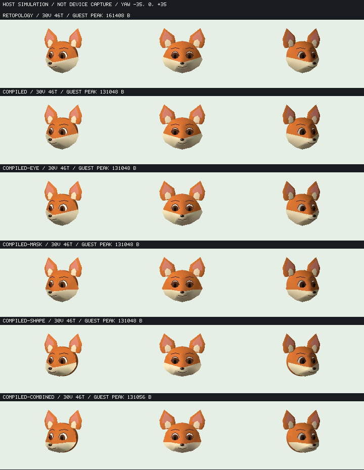

# 狐の事前コンパイルnative資産とFOX SHEET

固定topology/materialを既存Modelへ移し、同じ狐でメモリと画質を比較した。**移行だけの条件は全78frameの画像hashを維持し、m32 guest会計peakを161408→131048 Bへ削減**。これは同じnative binary・同じ160 KiB上限・通常GCでのhost測定で、ESP実測値やGC時間の削減率ではない。



各行は同じyaw −35/0/+35°・固定world light・240×135。上からJS定義の対照、native移行のみ、眼のみ、毛色のみ、形状のみ、組合せ。画像は**ホストシミュレーション**であり実機captureではない。

## 採否

固定資産化は採用。眼・mask・XYZを変える前のcompiled条件は対照と全78frame／3captureが一致し、2processで再現した。毛色と曲率を混ぜずに3因子を比較し、組合せは別app [FOX SHEET](../../apps/foxsheet/README.md) の中立表情候補として採用する。既定FOX FACEは変更しない。

独立18画像レビューでは、眼だけは白目の縁が読みやすくなり、shapeだけは角顎が丸まって鼻口吻との連続が改善。maskだけは鋭いV字を弱める一方、白橙の横帯へ置換した面もあり、固有色境界の問題は未解決。組合せも狭い口線・頬毛・浅い眼窩・丸頭・斜めで見える背後skullの縁が残る。完成狐／表情morph／一般遮蔽の受入ではない。

## 同一binaryの比較条件

Linux host i386/SSE2、FMA contraction OFF、QuickJS cap163840 B、GC threshold81920 B、frameごとの強制GCなし。`--compiled-provider`でJS対照にも同じC資産providerを組み、同じbinaryを使う。readonly資産はCのconst spanから直接参照し、FS→JS buffer→巨大object graphの復元は行わない。

binary SHA256: `b09fb977f9533b591ce17412ee98568ffe20b2f14573cf6a4b14ecf6cca8ea2d`。各条件78frame×2process、3capture、61yaw sweep、世界光変更、停止8frame、無効view、3回release/recreateを検証。source／生成物／object／binaryのbefore/after hashが不変、全frame incremental/full-reference一致、画像／frame hash列の反復一致、終了guest/live0。条件ごとの自動guardを破る途中source変更はFAILとして別保存し、採用値に使わない。

| m32条件 | requested peak B | guest会計peak B | 最大単一request B | 78frame中alloc呼出 |
| --- | ---: | ---: | ---: | ---: |
| JS形状定義・29node対照 | 143776 | 161408 | 12612 | 7366 |
| native移行のみ・17node | 117216 | 131048 | 5587 | 5563 |
| 眼のみ | 117216 | 131048 | 5587 | 5563 |
| 毛色のみ | 117216 | 131048 | 5587 | 5563 |
| 形状のみ | 117216 | 131048 | 5587 | 5563 |
| 組合せ | 117224 | 131056 | 5587 | 5563 |

移行のみのguest差30360 B、requested差26560 B。旧a5の160784 Bをこの表の対照へ流用していない。新しいmetadata照会とwrapperも含む同条件の対照は161408 Bである。cold固定data／JS helperの削除、不要native部品のoffline prune、handle数削減をまとめた経路全体の差で、binファイル圧縮だけの効果ではない。

native actorの元資産29nodes/cold3620 B/arena9192 Bから、未使用部品を除いた17nodes/cold3512 B/arena5580 Bへ。30頂点46面と穴は固定のままで、面数を増やしていない。Model metadataのsection表は32 B増えており、旧assetのnode work／cloud arenaは維持した。arenaはguest allocatorで会計され、160 KiBの外へ逃がしていない。

viewer補助のtyped backingは3414→730 B。別にNative Sceneのtarget/camera staging、JS object／bytecode、clip、display resource、packet snapshot等があり、この2値をguest peakへ単純加算しない。Modelのworkはprefix84 B＋最大packet1040 B＋XY/depth、30v mesh slot1488 Bを含む。native snapshotは寿命・repairのため維持した。最大request5587 Bは5580 B arenaの8-byte整列用+7 B要求と一致するが、他の内訳は実測なしで配分しない。

## 実appと寿命

正式chunksをloadするFOX SHEET専用host試験はASan/UBSan64bitとm32で各130frame×2processを通過。9capture（yaw3×light3）、31yaw／61light sweep、停止、入力拒否、UP held、6回release/reload plateau、load失敗→前画像維持→retry、終了guest/live0を確認した。load失敗注入はsyntheticなmodelBuiltin例外で、実OOMとは区別する。

m32実appのrequested peak123380 B／guest会計peak138116 B／最大request5587 B。上限まで25724 Bの差があるが、物理ESP largest freeや将来大口allocの保証ではない。64bit ASanのguest186364 Bは別profileで、160 KiB予算へ比較しない。

最初の実app試験では、helperとappが同frameで二重に`K.replace`しBUSYになった。sleep調整ではなく、helperのUI公開を既定OFF、appを唯一のview所有者へ変更して、同じ試験を再実行した。Model/Instanceのrelease後も提出画像が有効なことと、app終了の全解放を別々に確認する。

既定FOX FACEもm32 243frame×2process、全描画参照／4表情／解放再生成を通過（guest peak155720 B、終了0）。Model/Instanceの実QuickJS試験はASan/UBSanとm32で、共有2個体、close/GC両順、metadata owner/alias、未対応材質のsetter拒否とpending pose保持、1000回無確保、追加64位置OOM／18注入失敗と既存192位置試験の回復を通過した。

## 独立検証と未計測

- C core: cold変異20000、unaligned8通り、極端TRS1000、packet8239／mask32956／arena guardを検証。共通materialの非canonical値3種とsparse配列3種を拒否する修正を独立再確認。
- shade抽出: 旧関数との100000入力比較。有効94117件でRGB565完全一致、zero direction5883件の拒否も一致。
- 五つのcompiled surfaceについて整数pixel中心・inclusive bbox・canonical edgeのnearest-Z参照45viewは差分0。逆順の負例は旧形状60／変更形状50画素の差を検出。別の眼・鼻・skullとの遮蔽、連続角度域、実appのpitch操作は保証しない。
- Xtensa GCC15.2/O2の単体stack参考値: evaluate旧1104 B→1072 B、mesh helper784 B、visibility752 B。noinlineで非使用経路の増加を避けた一方、既知mesh callchainは2112→2608 B。上位JS／libgcc／実機stack peakは別で未計測。

ホストの表からESP速度・定常／peak・GC時間・物理LCD画質は導けない。a418の[雲A/C](cloud-memory-fixture.md)は別SHA／別model／診断条件であり、本候補の結果ではない。023559fの実機確認は次節に分ける。

## 023559fの実機smoke（2026-10-31、別担当の報告）

対象は`023559f29fd22a3bc483064baab520d2652c45f5`、通常TRACE/phase-only OFF/OFF。12:36:10 UTCにflash・readback・boot ELF一致を確認。FOX SHEETはyaw／world light／release-reload 3往復／resetの14入力、既定FOX FACEは4表情／yaw／light／resetの11入力をconsumed。両者STOP/CLOSE成功、12:38:51にfresh HOMEへ戻った。assert/panic/OOM/draw errorのログなし、ログ欠落なし。これは画質受入や失敗注入試験ではない。

| 観測窓 | FOX SHEET | FOX FACE |
| --- | ---: | ---: |
| 起動後・初回描画前 guest B | 75340 | 69452 |
| 同時点 ESP free B | 122212 | 128128 |
| 同時点 ESP largest B | 59392 | 59392 |
| APP_ID→初回描画通知 ms | 528 | 481 |
| STOP後 guest B | 0 | 0 |
| STOP後 ESP free / largest B | 207752 / 69632 | 207752 / 69632 |

**初回前とSTOP後のphase値であり、peak・定常・FPS・GC時間・stack余裕ではない。** release/reload中の個別メモリ推移は未取得。表示captureとapp_sessionの正式併用経路がないため画像は未取得、物理LCD画質も未受入。上の画像は引き続きホスト画像である。

同boot `11651282494201920168`、終了時owner/lease/job/queue/sessionなし。初回catalog_changedは未実行照合後fresh catalogで再準備、flash後continuation期限切れは通常queueの再待機で処理し、他job介入なし。一次記録は実機担当の`hone110-023559f2-device-result-20261031.json`とflash-evidence。本文はその報告を転記したもので、独立した再実測ではない。後続のローカル造形案をこの実機SHAの実績へ混ぜない。

## 再現

```sh
node tools/ayatsuri/model/export_fox_patch.cjs --check-product
node tools/ayatsuri/model/export_fox_patch.cjs
python3 tools/character/test_compiled_fox_depth.py
python3 tools/ayatsuri/model/run_model_contracts.py --m32
python3 tools/kasane_contract/run_fox_sheet_app_host.py --m32
python3 tools/kasane_contract/run_fox_patch_host.py --m32 --compiled-provider --variant retopology
python3 tools/kasane_contract/run_fox_patch_host.py --m32 --variant compiled
python3 tools/kasane_contract/run_fox_patch_host.py --m32 --variant compiled-combined
```

証拠は`.cache/fox-patch-host/`、`.cache/fox-sheet-app-{asan,m32}/`、`.cache/ayatsuri-model-contracts/`、`.cache/fox-compiled-depth/`。独立のfrozen source／数値試験／target stackは`.cache/mesh-independent/`。同head CIと製品linkはこれらのhost測定と分けて追跡する。
