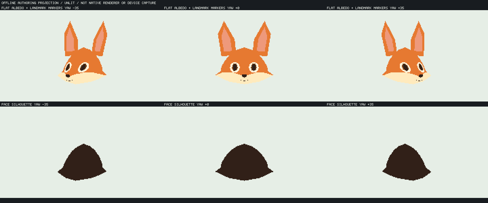
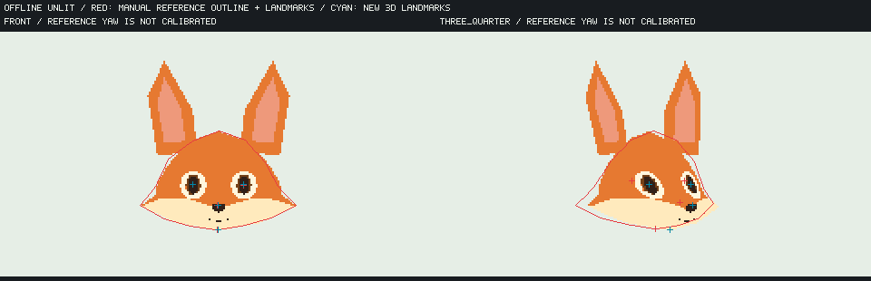
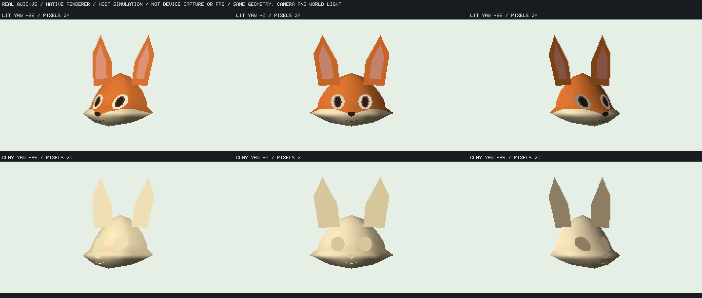

# 設定図から取り直した狐顔の無陰影・native陰影実証

既存モデルの頬幅や頭の楕円体係数だけを調整する方法は打ち切り、設定図から輪郭・眼・鼻・白毛境界を取り直した。既定FOX FACE／FOX SHEETと実機023559fは変更していない。前半はオフラインの無陰影制作比較、後半は実QuickJS／native rendererのホスト試験。実機性能や造形の合格とは分ける。



上段は固有色のみ、下段は耳を除く顔の輪郭。yaw −35/0/+35°、240×135を最近傍2倍表示した。照明・ハイライト・テクスチャ画像は使っていない。眼は配置を判断するための平たいマーカーであり、完成した眼球・瞼・表情rigではない。

## 参照と作り直した要素

参照はユーザー設定図 `fox-character-sheet-volume-muzzle-v2.png`（Library `libfile_6be7d8a574e88191a1b4c8bb83517684`）。画像SHA256は `3c1d6d81ca613d501277898fc2bcda220931694a67687e294b9c9a7dc02870a5`。FRONT／3/4／SIDEの手動近似点を [fox_reference_landmarks.json](../../tools/character/fox_reference_landmarks.json) に保存した。中心点は概ね±3 px、毛先・額境界は±5〜8 px程度の見取りであり、自動抽出や正確な多視点復元ではない。各絵には非対称と投影不整合がある。

| 耳を除く正面顔の比率 | 参照の手動近似 | 新規authoring |
| --- | ---: | ---: |
| 外頬幅／額面〜顎高 | 1.578 | 1.571 |
| 眼中心間距離／外頬幅 | 0.3256 | 0.3258 |
| 額面から鼻まで／顔高 | 0.7523 | 0.7524 |

右列は**作成したランドマークの比率**であり、レンダリングから再測定した誤差でも品質スコアでもない。顔幅は頭蓋球ではなく頬毛の外端、額は前髪の毛先と区別した。

新しい面は旧モデルの頂点やローブを流用していない。顔の断面幅と奥行きprofileから連続する74頂点128三角形を作り、鼻へ続く部分を同じ面で前へ出した。頬に独立球を追加せず、固有色境界は頬下から中央鼻下へ湾曲する別データとした。耳根は頭へ重なる位置へ接続した。



赤は手動参照輪郭と眼・鼻・顎の点、水色は新しい3Dのランドマーク。正面と斜めで確認する。参照3/4の実yawは未校正であり、右図のyaw35°との点距離を正確な投影誤差や合格値にしない。

## 実装と検証した境界

[生成スクリプト](../../tools/character/fox_asset_redesign.py) は標準Pythonと既存Node packerだけを使用する。

```text
python tools/character/fox_asset_redesign.py
python tools/character/fox_asset_redesign.py --out-dir .cache/fox-asset-redesign-repeat
```

基本出力は `model.json`／`model.aynm`／`authoring.json`／2枚のPNG／`proof.json`、照明用の派生資産は `lit/`／`clay/`。既存AYNM packerで16 node、8960 Bの固定native資産へコンパイルできる。正面windingと口の明示的な2面分割を整理した無陰影資産SHA256は `44e166fcd72eae8bcf87c27437bad18688cc16ff8f6421fb868a3070ba572d29`。native各meshの32頂点／64面制限内で事前分割し、計算した法線と固有色データも固定資産に含める。

前半PNGは制作確認用の**オフラインdepth-buffer投影**であり、製品へZbufferを追加したものではない。AYNMがcompileできた事実だけから面順・眼clip・morph・メモリ予算が通ったとは言わない。製品providerへは登録せず、JS appへの巨大な頂点graph展開も行っていない。固定native資産を共有し、pose／表情を個体別mutable instanceに持たせる既存方針を維持する。

## 画像判定と次の受入

rootと独立画像レビューは、旧円頭・白頬球・円筒状の独立口吻から離れ、**同じ形状を固定して陰影実証へ進める土台**と判断した。製品造形の合格ではない。

- 輪郭：横の頬端と短い鼻下は設定図の方向へ進む。ただし頭頂が尖った釣鐘状に見える。
- 眼：参照を基準に配置を作り直したが、現マーカーの大きさ・瞼・眼窩への収まりは未受入。
- 口吻：斜めで鼻先が前へ出る。丸い量感が出るかは同geometryのclay／固定光で判定する。
- 白毛：水平な帯から曲線へ変えたが、斜めでは横長の扇にも見える。陰影で隠して合格にしない。

## 同じ形状のnative陰影試験



上は固有色＋照明、下は同じgeometry／normal／maskを持つ単色clay。固定世界光と同じcameraでyaw −35/0/+35°を描画した。実機captureでもESP速度でもない。

native用生成では正面の全206面を正のwindingに統一し、凸polygonのfanは凸性を検査、凹形の口は非重複2面を明示する。runtimeで裏面を反転したりvisibility検査を緩めたりしていない。無陰影のambient1材質を光変化検査へ流用せず、lit／clayにambient .28・diffuse .72の同一材質を持たせる。資産SHA256はlit `46e063fc4fb9a7e42667dbf5514bd92e5fa0cc9eebd8b38df2ec7f53c3a179a6`、clay `8b6ebb62baa0c4823dcee58e8eee3507842548aab3e5d52854ef1025e3f21ede`。

専用fixtureはroot ID 0と世界光だけを更新する。旧狐の眼・鼻・耳・extra75のnode契約は使用しない。固定資産はhost専用provider、poseと参照寿命は既存Model／Instanceが所有し、scene→modelの順に明示disposeする。既定製品のprovider・描画kernel・資産は変更していない。

```text
python tools/character/fox_asset_redesign.py
python tools/kasane_contract/run_fox_patch_host.py --m32 --redesign --variant compiled-combined --compiled-assets-dir .cache/fox-asset-redesign/lit --result-dir .cache/fox-redesign-m32-lit
python tools/kasane_contract/run_fox_patch_host.py --m32 --redesign --variant compiled-combined --compiled-assets-dir .cache/fox-asset-redesign/clay --result-dir .cache/fox-redesign-m32-clay
python tools/character/fox_redesign_contact.py --lit-result .cache/fox-redesign-m32-lit/result.json --clay-result .cache/fox-redesign-m32-clay/result.json --out .cache/fox-redesign-native-host.png
```

最終m32試験ではlit／clayそれぞれ78frame×2process、全frame incremental/full-reference一致、光±90°による画像変化、無効yaw／光入力時の旧commit保持、停止8回の画素一致、3回release/recreate、終了guest/live0、2process全framehashとcapture一致を通過した。ASan／UBSanの64bit litも78frame×2processを通過。旧compiled-combined経路のm32回帰も78frame×2processを通し、保存した旧結果と全framehash／capture一致を確認した。資産と無陰影画像の2回再生成もbyte一致した。

m32 lit／clay各guest会計peak83596 B、rounded request peak77040 B、最大単一request19731 B、native arena payload19724 B。arenaはguest会計に含まれ、別RAMへ逃がした数字ではない。これは**専用fixtureの会計**であり、旧FOX appより省メモリになったという比較ではない。JS app全体・表情追加後やESP heap／stackの余裕は未測定。停止中のdirty counter不変、全角度の遮蔽の正しさも別の未検証項目である。

陰影レビューでは、独立球・円筒の組立感が消えた一方、白面全幅が横へ張り出す楔／顎板、頭頂の釣鐘状の曲率が明確になった。clayでも形状そのものを判定し、毛色を変えて隠す案は採用しない。**native試験のPASSと製品造形の受入を分け、現案は製品へ採用しない。** 次の造形は頬全幅の奥行きと中央マズルの丸い量感を分けて設計し、合格した形状をmorphへ進める。現時点ではmorph、実機RAM・速度・画質、全身・他キャラ・2.5Dの完成は主張しない。

[既存頬造形の比較](fox-cheek-authoring-study.md) · [native mesh契約](../api/ayatsuri-native-mesh.md)
