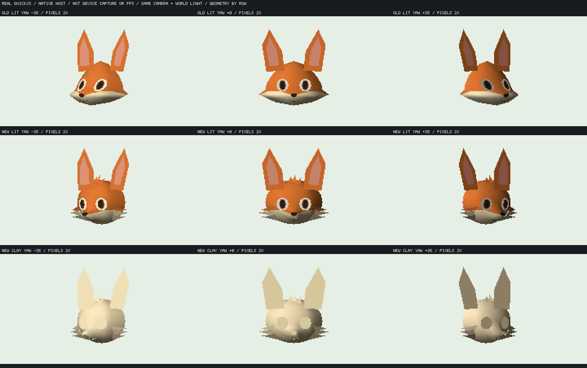
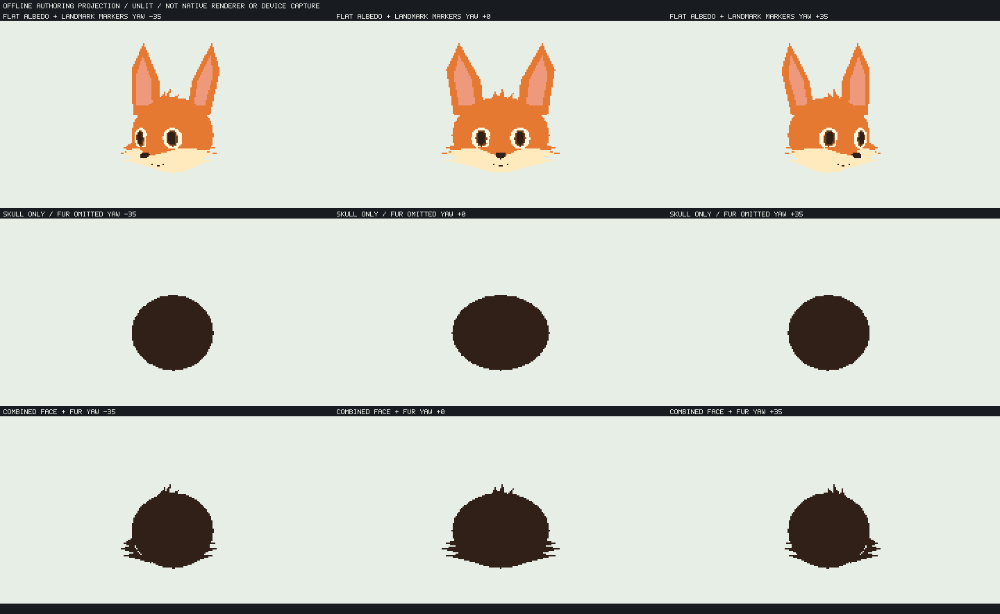

# 狐の頭蓋・局所マズル・輪郭毛束の分離

4acb68fの[設定図からの再設計](fox-reference-redesign.md)で残った尖頭と棚状下顔に対し、毛束の見かけ輪郭を頭蓋へ写す方法をやめ、造形の自由度を分けた。既定FOX FACE／FOX SHEETと実機023559fは変更していない。



全列yaw −35/0/+35°、同じcamera（zoom1.3、中心120/87）と固定世界光。実QuickJS／native rendererの**ホストシミュレーション**を最近傍2倍表示した。上段は旧案lit、中段は新案lit、下段は新案clay。実機captureやFPSの証拠ではない。

## 分けた意味と生成経路

- 頭蓋は滑らかな楕円front surfaceとして独立定義する。参照の毛束を含む上端y82をsmooth surfaceの頂点へ変換しない。
- 中央マズルだけに局所変位を与える。`s=(x/11)^2+((y-8)/8)^2`、`deltaZ=14*max(0,1-s)^2`。解析場は支持域外で変位・勾配とも0となり、外頬へ前突量を配らない。
- 頬毛と前髪の輪郭は別の9三角形として作る。これらを頬の球体や滑らかな頭蓋の頂点に混ぜない。根元も上記支持域外に置く。

数値はmodel-localの任意単位、x右・y下・zカメラ側。cameraのzoomでpixelへ投影する。SI単位や生体の忠実な形状ではない。解析場を頂点へサンプルし、法線を生成してnative資産へ格納する。三角形補間と共有頂点法線は解析場の支持境界やC1を厳密保存しないので、native全pixelの外頬不変とは主張しない。



無陰影を先にレビューし、丸い頭蓋の基体と輪郭毛束の分離が確認できてから、同じgeometryのnative lit/clayへ進めた。上図は制作確認用のオフラインdepth-buffer投影であり、製品へZbufferを導入したものではない。

[生成スクリプト](../../tools/character/fox_surface_separation.py) は既存生成器へ明示的なauthoring／config／surface関数を渡す。global関数の書換えは行わない。旧生成器の既定経路ではmodel／authoring data／無陰影PNG／landmark PNGのbyte一致を確認した。

```text
python tools/character/fox_surface_separation.py
python tools/kasane_contract/run_fox_patch_host.py --m32 --redesign --variant compiled-combined --compiled-assets-dir .cache/fox-surface-separated/lit --result-dir .cache/fox-separated-m32-lit
python tools/kasane_contract/run_fox_patch_host.py --m32 --redesign --variant compiled-combined --compiled-assets-dir .cache/fox-surface-separated/clay --result-dir .cache/fox-separated-m32-clay
python tools/character/fox_redesign_contact.py --old-lit-result .cache/fox-redesign-m32-lit/result.json --lit-result .cache/fox-separated-m32-lit/result.json --clay-result .cache/fox-separated-m32-clay/result.json --out .cache/fox-separated-native-host.png
```

旧案の結果は前資料の手順で生成する。新案も固定native資産＋可変instanceであり、JSへ頂点graphを展開しない。旧製品assetの上書き、renderer・loaderの新機能、resource上限の変更はない。

## 測定した費用

| 同じ専用fixtureの条件 | 旧案 | 新案 | 差 |
| --- | ---: | ---: | ---: |
| cold資産 bytes | 8960 | 11464 | +2504 |
| node／mesh数 | 16／15 | 26／25 | +10／+10 |
| cold頂点／面数（batch重複含む） | 196／206 | 242／231 | +46／+25 |
| native instance arena payload B | 19724 | 31756 | +12032 |
| m32 guest会計peak B | 83596 | 96120 | +12524 |
| rounded guest request peak B | 77040 | 89564 | +12524 |
| 最大単一guest request B | 19731 | 31763 | +12032 |

新案の顔基体単体は83頂点144面。native arenaはguest会計内であり、native化で会計外RAMへ移した数字ではない。追加の頭蓋batchと9毛束部品を含む比較で、費用差を毛束だけの費用へ分離した試験ではない。全FOX appや実機のheap／largest／stack／速度とは別である。

新案lit／clayのm32は各78frame×2process、160KiB／resource1024維持、強制frame GCなし。光±90°の画像差、全frame incremental/full-reference一致、無効入力で旧commit保持、停止8回の画素一致、3回release/recreateのplateau、終了guest/live0、2process画像・framehash一致を通過した。64bit ASan／UBSan litも78frame×2process PASS（guest会計peak122248 B、m32と混同しない）。停止中のdirty counter不変や一般の遮蔽正解は未検証。

## 画像判定

独立画像レビューでも、旧尖頭と白面全幅の暗い棚は明確に軽減し、丸い頭蓋・中央に限定された前突へ変わったと確認した。これは形状構成の前進として保持する。

一方、鼻下〜顎の中央塊は大きく、原画の小さい中央マズルと左右頬毛の配分には届かない。側毛はlit／clayとも硬い水平線・積層したヒゲに見え、柔らかな頬毛ではない。耳板と眼／鼻マーカーも未完成。**構成の検証土台として有効だが、現形状は既定製品へ採用しない。** 表情morph・全身・実機画質・他キャラ・2.5Dの完成へ数えない。
